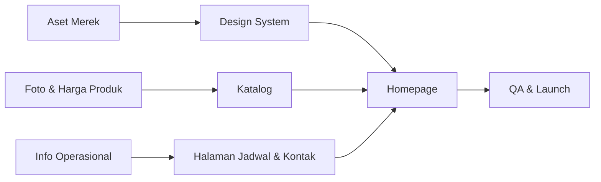

# Pertanyaan Terbuka — Delisert Website

| Metadata | |
|---|---|
| **Dokumen** | Open Questions, Assumptions & Missing Information |
| **Versi** | 1.1 |
| **Tanggal** | 30 Oktober 2026 |
| **Tujuan** | Mencegah pengarang data; menandai setiap informasi yang belum terkonfirmasi |
| **Terintegrasi dengan** | `docs/PRD.md`, `docs/BUSINESS_RESEARCH.md` |

---

## 1. Cara Membaca Dokumen Ini

Setiap pertanyaan memiliki:

- **ID** — referensi unik
- **Prioritas** — `Kritis` (memblokir launch), `Tinggi` (memblokir halaman tertentu), `Sedang` (memengaruhi kualitas), `Rendah` (nice to have)
- **Dampak** — apa yang terjadi jika tidak dijawab
- **Workaround** — apa yang dilakukan website sementara waktu

**Aturan utama:** Tidak ada informasi yang dikarang. Jika pertanyaan belum dijawab, website menampilkan workaround yang jujur, bukan data palsu.

---

## 2. Pertanyaan Kritis (Memblokir Launch)

### Q-01 — Logo Resmi dan Aset Merek

| Atribut | Detail |
|---|---|
| **Prioritas** | Kritis |
| **Pertanyaan** | Apakah Delisert memiliki logo resmi? Dalam format apa (SVG, PNG transparan)? |
| **Dampak** | Homepage, navigasi, footer, dan favicon tidak dapat menggunakan identitas merek yang benar |
| **Workaround** | Gunakan logotipe teks "DELISERT" dengan tipografi elegan sebagai placeholder sementara |
| **Yang Diminta** | File logo (SVG diutamakan), variasi horizontal & vertikal, versi untuk latar terang & gelap |

---

### Q-02 — Palet Warna Merek

| Atribut | Detail |
|---|---|
| **Prioritas** | Kritis |
| **Pertanyaan** | Apakah Delisert memiliki warna merek resmi? Jika ya, berapa kode HEX-nya? |
| **Dampak** | Seluruh design system (tombol, badge, aksen) tidak dapat ditentukan |
| **Workaround** | Gunakan palet netral hangat (krem, cokelat muda) sebagai arah sementara |
| **Yang Diminta** | Kode HEX warna utama, sekunder, dan aksen; atau contoh konten visual yang paling disukai pemilik |

---

### Q-03 — Foto Produk Asli

| Atribut | Detail |
|---|---|
| **Prioritas** | Kritis |
| **Pertanyaan** | Kapan foto produk asli untuk kelima kategori dapat disediakan? |
| **Dampak** | Homepage, katalog, dan detail produk tidak dapat menampilkan produk nyata |
| **Workaround** | Gunakan placeholder berkualitas tinggi dengan label jelas; **blokir launch visual** sampai foto diterima |
| **Yang Diminta** | Foto per produk, resolusi minimal 1600×1600px, latar konsisten, beberapa angle, satu foto "hero" untuk homepage |

---

### Q-04 — Harga Produk

| Atribut | Detail |
|---|---|
| **Prioritas** | Kritis |
| **Status** | **SEBAGIAN SELESAI (2026-10-31)** — harga 7 item sudah diterima dan diterapkan ke seluruh halaman publik. Sisa 1 produk: Mille Crepes (lihat Q-30) |
| **Pertanyaan** | Berapa harga setiap produk dan variannya? |
| **Dampak** | Katalog tidak dapat menampilkan harga; keputusan pembelian pelanggan terganggu |
| **Workaround** | Tampilkan "Hubungi untuk harga" secara elegan — bukan "Rp 0", bukan angka kosong |
| **Yang Diminta** | Daftar harga per produk per varian; konfirmasi apakah harga berubah sesuai musim/batch |

**Harga resmi yang sudah diterima (2026-10-30):**

| Produk | Harga |
|---|---|
| Dubai Chewy Cookie | Rp 30.000 |
| Mango Sticky Rice | Rp 30.000 |
| Pancake Durian | Rp 35.000 (datar, bukan isi 4 / isi 8) |
| Mochi — 1 pcs | Rp 8.000 |
| Mochi — isi 4 | Rp 30.000 |
| Mochi — isi 8 | Rp 50.000 |
| Mille Crepes | **belum ada** — tampil `Rp —` + "Harga menyusul" |

**Tambahan diterima 2026-10-31:**

| Produk | Harga | Varian |
|---|---|---|
| Slice Cake — 1 slice | Rp 16.000 | Lotus Biscoff, Red Velvet, Coklat |

Daftar ini sudah diterapkan ke Homepage, Menu, Detail Produk, dan seluruh screen terkait.
Rincian verifikasi per screen ada di `docs/DESIGN_AUDIT.md`.

**Catatan riset:** Tidak ada harga yang terlihat di Instagram, Threads, atau sumber publik mana pun yang berhasil diakses.

---

### Q-05 — Varian Produk

| Atribut | Detail |
|---|---|
| **Prioritas** | Kritis |
| **Pertanyaan** | Apa saja varian rasa/ukuran untuk setiap produk? Story highlight menyebut "Varian mochi" dan "🍑Varian mochi🍡". |
| **Dampak** | Detail produk tidak dapat menampilkan pilihan varian; pesan WhatsApp tidak dapat menyertakan varian |
| **Workaround** | Tampilkan produk tanpa varian; pesan WA generik |
| **Yang Diminta** | Daftar varian per produk, termasuk nama varian, harga (jika berbeda), dan ketersediaan |

---

## 3. Pertanyaan Prioritas Tinggi

### Q-06 — Kode Pos yang Benar

| Atribut | Detail |
|---|---|
| **Prioritas** | Tinggi |
| **Pertanyaan** | Kode pos yang benar: 90233 atau 90234? |
| **Dampak** | Alamat operasional tidak lengkap; pengiriman kurir dapat terganggu |
| **Workaround** | Sembunyikan kode pos sampai dikonfirmasi |
| **Yang Diminta** | Satu angka yang benar |

---

### Q-07 — Status Pengambilan Pelanggan di Alamat Operasional

| Atribut | Detail |
|---|---|
| **Prioritas** | Tinggi |
| **Pertanyaan** | Apakah pelanggan boleh mengambil pesanan langsung di alamat Villa Surya Mas? |
| **Dampak** | Website tidak boleh menyebut alamat sebagai "toko" atau "cabang"; instruksi pengambilan tidak dapat dirinci |
| **Workaround** | Tampilkan alamat sebagai "alamat operasional" tanpa jam buka; arahkan pemesanan ke WhatsApp |
| **Yang Diminta** | Ya/tidak; jika ya, jam pengambilan yang diperbolehkan |

**Catatan:** Story highlight "CCTV DELISERT" mengindikasikan ada pengambilan pesanan, tetapi ini belum konfirmasi eksplisit.

---

### Q-08 — Deskripsi Produk

| Atribut | Detail |
|---|---|
| **Prioritas** | Tinggi |
| **Pertanyaan** | Apakah Delisert ingin menulis deskripsi produk sendiri, atau mengizinkan tim menulisnya untuk direview? |
| **Dampak** | Katalog dan detail produk tidak memiliki teks deskriptif |
| **Workaround** | Gunakan deskripsi singkat netral berdasarkan nama produk; minta review pemilik |
| **Yang Diminta** | Preferensi penulisan; informasi bahan utama, tekstur, rasa, dan ukuran per produk |

---

### Q-09 — Jam Operasional CFD Minggu

| Atribut | Detail |
|---|---|
| **Prioritas** | Tinggi |
| **Pertanyaan** | Jam berapa Delisert berjualan di CFD pada hari Minggu? |
| **Dampak** | Pelanggan tidak tahu kapan harus datang |
| **Workaround** | Tampilkan "Lokasi dan jam diumumkan melalui media sosial Delisert" |
| **Yang Diminta** | Rentang jam operasional CFD |

---

### Q-10 — Frekuensi Lokasi CFD

| Atribut | Detail |
|---|---|
| **Prioritas** | Tinggi |
| **Pertanyaan** | Apakah kedua lokasi (Boulevard dan UNHAS) aktif setiap Minggu, atau bergantian? |
| **Dampak** | Website tidak boleh menjamin ketersediaan lokasi |
| **Workaround** | Tampilkan kedua lokasi sebagai "titik penjualan yang diketahui" dengan catatan bahwa lokasi terkini diumumkan via sosial media |
| **Yang Diminta** | Pola rotasi lokasi (jika ada) |

---

## 4. Pertanyaan Prioritas Sedang

### Q-11 — Sertifikasi Halal

| Atribut | Detail |
|---|---|
| **Prioritas** | Sedang |
| **Pertanyaan** | Apakah Delisert memiliki sertifikasi halal resmi (BPJPH)? Dapatkah dokumentasinya dibagikan? |
| **Dampak** | Klaim "100% HALAL" tidak boleh ditampilkan sebagai sertifikasi resmi |
| **Workaround** | Tampilkan sebagai klaim bisnis ("Produk 100% halal sesuai keterangan pemilik") atau sembunyikan sampai diverifikasi |
| **Yang Diminta** | Nomor sertifikat dan masa berlaku, atau konfirmasi bahwa ini klaim tanpa sertifikat |

---

### Q-12 — Layanan Shopee yang Digunakan

| Atribut | Detail |
|---|---|
| **Prioritas** | Sedang |
| **Pertanyaan** | Layanan Shopee apa yang digunakan — ShopeeFood, Shopee Express, atau toko Shopee? |
| **Dampak** | Informasi pengiriman tidak akurat |
| **Workaround** | Tampilkan "Shopee" generik dengan catatan "dikonfirmasi saat pemesanan" |
| **Yang Diminta** | Nama layanan spesifik |

---

### Q-13 — Cakupan dan Tarif Pengiriman

| Atribut | Detail |
|---|---|
| **Prioritas** | Sedang |
| **Pertanyaan** | Area mana saja yang dijangkau pengiriman? Berapa tarifnya? |
| **Dampak** | Pelanggan tidak tahu apakah lokasi mereka terjangkau |
| **Workaround** | Tampilkan metode pengiriman tanpa tarif; arahkan konfirmasi ke WhatsApp |
| **Yang Diminta** | Daftar area, tarif per layanan, estimasi waktu |

---

### Q-14 — Klaim "Pelopor 1 Mochi di Jl. Boulevard"

| Atribut | Detail |
|---|---|
| **Prioritas** | Sedang |
| **Pertanyaan** | Apakah klaim ini akurat dan ingin ditampilkan di website? |
| **Dampak** | Klaim pemasaran yang tidak terverifikasi dapat menimbulkan risiko reputasi |
| **Workaround** | Sembunyikan sampai dikonfirmasi |
| **Yang Diminta** | Konfirmasi akurasi dan keinginan menampilkan |

---

### Q-15 — Kategori "Mochi Birthday" dan "Small Wholecake"

| Atribut | Detail |
|---|---|
| **Prioritas** | Sedang |
| **Status** | **SEBAGIAN TERJAWAB (2026-10-31)** — salah satu produk dalam lini "Small Wholecake" sudah terkonfirmasi: **Slice Cake 1 slice Rp 16.000** dengan varian Lotus Biscoff, Red Velvet, dan Coklat. Sisanya (Mochi Birthday, wholecake ukuran besar) masih belum dikonfirmasi. |
| **Pertanyaan** | Apakah kedua kategori ini masuk katalog website? Keduanya terlihat di story highlights Instagram. |
| **Dampak** | Katalog tidak lengkap; pelanggan mencari produk acara tidak menemukannya |
| **Workaround** | Sampaikan melalui WhatsApp; tambahkan kategori di Fase 2 |
| **Yang Diminta** | Konfirmasi kategori, produk di dalamnya, harga, dan lead time pre-order |

---

### Q-16 — Testimoni Pelanggan

| Atribut | Detail |
|---|---|
| **Prioritas** | Sedang |
| **Pertanyaan** | Apakah testimoni pelanggan dapat ditampilkan di website? Apakah izin tertulis tersedia? |
| **Dampak** | Aset kepercayaan tidak dapat digunakan |
| **Workaround** | Sembunyikan section testimoni |
| **Yang Diminta** | Teks testimoni, nama pelanggan (atau inisial), izin penggunaan |

---

### Q-17 — Proses Ketersediaan Produk

| Atribut | Detail |
|---|---|
| **Prioritas** | Sedang |
| **Pertanyaan** | Bagaimana proses menentukan produk tersedia, pre-order, atau habis? Siapa yang memperbarui? |
| **Dampak** | Status ketersediaan dapat menjadi tidak akurat |
| **Workaround** | Tandai semua produk "Tersedia" secara default; minta pembaruan manual saat ada perubahan |
| **Yang Diminta** | Alur kerja ketersediaan; siapa yang bertanggung jawab memperbarui |

---

### Q-18 — Domain Website

| Atribut | Detail |
|---|---|
| **Prioritas** | Sedang |
| **Pertanyaan** | Domain apa yang akan digunakan? Apakah sudah terdaftar? |
| **Dampak** | Metadata SEO, canonical URL, Open Graph, dan sitemap memerlukan URL final |
| **Workaround** | Gunakan domain Cloudflare sementara; perbarui setelah domain final ditetapkan |
| **Yang Diminta** | Nama domain dan status registrasi |

---

### Q-19 — Bahasa dan Nada Konten

| Atribut | Detail |
|---|---|
| **Prioritas** | Sedang |
| **Pertanyaan** | Apakah website menggunakan Bahasa Indonesia formal, santai, atau campuran? |
| **Dampak** | Nada tulisan tidak konsisten |
| **Workaround** | Gunakan Bahasa Indonesia sopan namun hangat (default PRD) |
| **Yang Diminta** | Preferensi nada; contoh konten yang disukai |

---

### Q-20 — Target Pengukuran Keberhasilan

| Atribut | Detail |
|---|---|
| **Prioritas** | Sedang |
| **Pertanyaan** | Metrik apa yang paling penting bagi pemilik bisnis? |
| **Dampak** | Analitik mungkin mengukur hal yang salah |
| **Workaround** | Gunakan KPI default (klik WhatsApp, penayangan produk, trafik) |
| **Yang Diminta** | 2–3 metrik prioritas |

---

## 5. Pertanyaan Prioritas Rendah

### Q-21 — Filosofi atau Nilai Merek

| Atribut | Detail |
|---|---|
| **Prioritas** | Rendah |
| **Pertanyaan** | Apakah Delisert memiliki pernyataan misi, nilai, atau filosofi merek? |
| **Dampak** | Halaman Tentang kurang mendalam |
| **Workaround** | Sampaikan fakta berdiri 2021 dan posisioning produk |
| **Yang Diminta** | Pernyataan merek (jika ada) |

---

### Q-22 — Informasi Pendiri

| Atribut | Detail |
|---|---|
| **Prioritas** | Rendah |
| **Pertanyaan** | Apakah ada kisah pendiri yang ingin dibagikan? |
| **Dampak** | Halaman Tentang tidak memiliki narasi personal |
| **Workaround** | **Jangan mengarang kisah pendiri.** Tampilkan hanya fakta bisnis |
| **Yang Diminta** | Kisah yang ingin dibagikan (opsional) |

---

### Q-23 — Penghargaan atau Pencapaian

| Atribut | Detail |
|---|---|
| **Prioritas** | Rendah |
| **Pertanyaan** | Apakah ada penghargaan, sertifikat, atau pencapaian yang ingin ditampilkan? |
| **Dampak** | Tidak ada elemen kredibilitas tambahan |
| **Workaround** | **Jangan mengarang penghargaan.** |
| **Yang Diminta** | Daftar penghargaan dengan dokumentasi |

---

### Q-24 — Foto Kemasan Produk

| Atribut | Detail |
|---|---|
| **Prioritas** | Rendah |
| **Pertanyaan** | Apakah foto kemasan produk tersedia? |
| **Dampak** | Pelanggan tidak melihat bentuk kemasan |
| **Workaround** | Tampilkan foto produk saja |
| **Yang Diminta** | Foto kemasan per produk |

---

### Q-25 — Konten Video

| Atribut | Detail |
|---|---|
| **Prioritas** | Rendah |
| **Pertanyaan** | Apakah website akan menampilkan video produk atau embed TikTok/Instagram? |
| **Dampak** | Website lebih statis |
| **Workaround** | Tautkan ke media sosial daripada embed |
| **Yang Diminta** | Preferensi; URL video yang ingin ditampilkan |

---

### Q-26 — ID Numerik Project Google Stitch

| Atribut | Detail |
|---|---|
| **Prioritas** | Tinggi |
| **Status** | **SELESAI (2026-10-30)** — ID ditemukan, dicatat di `.env`, dan **dikonfirmasi pemilik proyek** |
| **Pertanyaan** | Berapa ID numerik project Stitch untuk `delisert premium website ui design`? |
| **Dampak** | Sebagian besar perintah Stitch (`generate`, `edit`, `serve`, `find screen`) memerlukan ID numerik, bukan nama tampilan |
| **Jawaban** | ID kanonik: `5848136313735450963` — judul "Delisert Premium Website UI Design", dibuat 2026-10-30T11:08Z, berisi `designTheme` "Haute Pâtisserie & Artisanal Deli" dan 22 screen (10 DESKTOP terstruktur + 12 screenshot referensi) |
| **Catatan** | Ada project kedua berjudul sama dengan huruf kecil (`8435499262000866002`, dibuat 13:27Z) yang masih kosong (0 screen). Tidak dipakai agar desain tidak terpecah. |
| **Sisa tindakan** | Tidak ada. |

---

### Q-29 — Kunci API Stitch: Dua Nilai Ditemukan

| Atribut | Detail |
|---|---|
| **Prioritas** | Sedang |
| **Status** | **PERLU KONFIRMASI (2026-10-30)** |
| **Pertanyaan** | Ada dua API key Stitch yang berbeda: satu disimpan di `.env`, satu lagi aktif di environment shell. Mana yang harus dipakai? |
| **Dampak** | Kedua key sama-sama berhasil autentikasi dan mengembalikan daftar project yang sama, sehingga tidak ada gangguan fungsi saat ini. Namun key yang kedaluwarsa akan berhenti bekerja tanpa peringatan. |
| **Temuan** | Key `.env` berhasil diverifikasi: `stitch status` → `authenticated: true`, `stitch find projects` → `success: true`. Key shell juga berhasil. Keduanya tampak masih aktif. |
| **Yang Diminta** | Konfirmasi key mana yang resmi; cabang/rotasi mana yang harus dipertahankan di `.env` |

---

### Q-27 — Masa Berlaku dan Cakupan API Key Stitch

| Atribut | Detail |
|---|---|
| **Prioritas** | Sedang |
| **Pertanyaan** | Berapa lama API key Stitch berlaku, dan apa cakupannya (hanya project ini atau seluruh workspace)? |
| **Dampak** | Jika key kedaluwarsa di tengah fase desain, generasi screen terhenti |
| **Workaround** | Key sudah tersimpan di `.env`; jika kedaluwarsa, minta key baru dan perbarui file tersebut tanpa mengubah `.mcp.json` |
| **Yang Diminta** | Konfirmasi masa berlaku; siapa pemilik key; apakah OAuth (`stitch login`) menjadi alternatif yang lebih tepat |

---

### Q-28 — Kepemilikan dan Berbagi Kredensial Stitch

| Atribut | Detail |
|---|---|
| **Prioritas** | Sedang |
| **Pertanyaan** | Siapa pemilik akun Google Stitch, dan apakah key boleh dipakai oleh tim/agent lain? |
| **Dampak** | Key yang dibagikan ke repository atau orang salah dapat disalahgunakan; kuota generasi terbatas pada satu akun |
| **Workaround** | Key hanya di `.env` lokal (ter-ignore git); tidak ditulis ke `.mcp.json` atau dokumen mana pun |
| **Yang Diminta** | Konfirmasi pemilik akun dan kebijakan berbagi |

---

### Q-30 — Harga Mille Crepes

| Atribut | Detail |
|---|---|
| **Prioritas** | Sedang |
| **Status** | **PERLU KONFIRMASI (2026-10-31)** |
| **Pertanyaan** | Berapa harga Mille Crepes? Produk ini satu-satunya yang belum punya harga resmi |
| **Dampak** | Kartu Mille Crepes di Homepage dan Menu tampil dengan `Rp —` + "Harga menyusul". Kalau dibiarkan begitu saat launch, pelanggan tidak bisa memutuskan membeli |
| **Workaround saat ini** | Tampil `Rp —` dengan label "Harga menyusul" — sesuai aturan PRD "jangan mengarang harga". Tidak memakai "Rp 0" atau angka kosong |
| **Yang Diminta** | Satu angka harga, plus konfirmasi apakah ada varian ukuran (mis. ukuran kecil/besar) dengan harga berbeda |

> **Catatan 2026-11-01 — dokumen tidak sinkron:** `docs/DESIGN_AUDIT.md` §2 dan seed database (`packages/db/src/seed.production.sql`) sudah mencantumkan **Mille Crepes Rp 16.000 per slice** dengan varian Lotus Biscoff, Red Velvet, dan Coklat. Tidak ada catatan terpisah kapan pemilik mengonfirmasi angka ini. **Pemilik perlu memastikan** sebelum deploy: kalau benar, tandai Q-30 dan Q-04 selesai; kalau salah, ubah harganya lewat halaman admin (atau di seed sebelum deploy pertama).

---

## 6. Asumsi yang Digunakan dalam PRD

Asumsi berikut digunakan untuk melanjutkan perencanaan tanpa diblokir. Setiap asumsi harus divalidasi.

| ID | Asumsi | Dasar | Jika Salah |
|---|---|---|---|
| A-01 | Tidak ada tim teknis internal; website harus mudah diserahkan | UMKM skala kecil | Perlu pelatihan atau dukungan berkelanjutan |
| A-02 | Trafik didominasi seluler via tautan Instagram/TikTok | Pola bisnis UMKM kuliner | Perlu optimasi desktop lebih |
| A-03 | Pelanggan sudah terbiasa memesan via WhatsApp | Instruksi bisnis menyertakan nomor WA | Perlu alur pemesanan lain |
| A-04 | Foto produk asli akan disediakan terpisah | Pernyataan pemilik | Launch visual terblokir |
| A-05 | Klaim "Pelopor" dan "100% HALAL" memerlukan verifikasi | Tidak ada dokumentasi | Sembunyikan klaim |
| A-06 | Alamat operasional bukan toko ritel publik | Alamat perumahan | Ubah penyajian menjadi lokasi ritel |
| A-07 | Katalog awal 5 kategori adalah daftar lengkap MVP | Permintaan pemilik | Tambahkan kategori Fase 2 |
| A-08 | Bahasa utama website adalah Bahasa Indonesia | Lokasi bisnis | Perlu versi bahasa lain |
| A-09 | Mochi adalah produk anchor | Bukti kuat dari bio & highlights | Ubah hierarki homepage |
| A-10 | Sistem batch/pre-order berlaku untuk beberapa produk | Caption Threads "PO Batch ke 2" | Perlu model ketersediaan berbeda |
| A-11 | Website adalah pendukung kredibilitas, bukan kanal konversi utama | Penjualan terpusat di TikTok Live | Ubah strategi konversi |
| A-12 | Tidak perlu CMS penuh pada MVP | Volume konten kecil | Perlu dashboard lebih awal |
| A-13 | Google Stitch (MCP `@google/stitch`) tersedia dan API key valid selama fase desain | Key sudah disediakan | Fase desain terblokir; minta key baru |
| A-14 | ID numerik project Stitch sudah ditemukan: `5848136313735450963` (diverifikasi 2026-10-30) | `stitch find projects --json` | Perintah Stitch terbatas; verifikasi ulang ID |

---

## 7. Informasi yang Diketahui Hilang

Daftar lengkap informasi yang tidak tersedia saat dokumen ini disusun:

| # | Informasi | Status |
|---|---|---|
| 1 | Logo resmi | Tidak tersedia |
| 2 | Palet warna merek | Tidak tersedia |
| 3 | Tipografi merek | Tidak tersedia |
| 4 | Foto produk (semua kategori) | Tidak tersedia |
| 5 | Foto merek / suasana bisnis | Tidak tersedia |
| 6 | Foto kemasan | Tidak tersedia |
| 7 | Harga produk | Tidak ditemukan di sumber publik |
| 8 | Varian produk | Tidak terbaca dari highlights |
| 9 | Deskripsi produk | Tidak tersedia |
| 10 | Bahan / alergen | Tidak tersedia |
| 11 | Ukuran / porsi | Tidak tersedia |
| 12 | Lead time pre-order | Tidak tersedia |
| 13 | Jam CFD Minggu | Tidak dikonfirmasi |
| 14 | Frekuensi lokasi CFD | Tidak dikonfirmasi |
| 15 | Status pengambilan pelanggan | Tidak dikonfirmasi |
| 16 | Kode pos benar | Tidak konsisten (90233/90234) |
| 17 | Layanan Shopee spesifik | Tidak pasti |
| 18 | Tarif pengiriman | Tidak tersedia |
| 19 | Cakupan pengiriman | Tidak tersedia |
| 20 | Estimasi waktu pengiriman | Tidak tersedia |
| 21 | Sertifikasi halal | Tidak ada dokumentasi |
| 22 | Testimoni + izin | Tidak terbaca |
| 23 | Filosofi merek | Tidak tersedia |
| 24 | Kisah pendiri | Tidak tersedia |
| 25 | Penghargaan | Tidak tersedia |
| 26 | Domain website | Belum ditetapkan |
| 27 | Metrik prioritas bisnis | Belum ditetapkan |
| 28 | Data TikTok (bio, pengikut, konten) | Akses gagal (DNS) |
| 29 | Data Google Maps (rating, review) | Akses gagal (JavaScript) |

---

## 8. Rencana Pengumpulan Informasi

### 8.1 Satu Pertemuan dengan Pemilik Bisnis

Susun agenda:

1. **Aset merek** (Q-01, Q-02) — minta logo, warna, tipografi
2. **Katalog produk** (Q-03, Q-04, Q-05, Q-08, Q-15) — foto, harga, varian, deskripsi, kategori tambahan
3. **Operasional** (Q-06, Q-07, Q-09, Q-10, Q-12, Q-13) — alamat, pengambilan, CFD, pengiriman
4. **Klaim & kepatuhan** (Q-11, Q-14) — halal, klaim pemasaran
5. **Konten & nada** (Q-16, Q-19, Q-20, Q-21, Q-22) — testimoni, bahasa, metrik, cerita merek

### 8.2 Urutan Pengerjaan Setelah Informasi Diterima

### 8.3 Yang Dapat Dikerjakan Sekarang (Tanpa Menunggu)

| Pekerjaaan | Keterangan |
|---|---|
| Skema database | Tidak bergantung pada konten |
| Router tRPC | Tidak bergantung pada konten |
| Struktur halaman & routing | Tidak bergantung pada konten |
| Komponen UI generik | Tidak bergantung pada konten |
| Utilitas WhatsApp | Hanya perlu nomor (sudah ada) |
| Konstanta jadwal & lokasi | Data sudah tersedia |
| Metadata SEO struktur | URL final masih diperlukan |
| Navigasi & footer | Logo masih diperlukan |
| Setup MCP Stitch & kredensial | Sudah dikonfigurasi di `.mcp.json` + `.env` |
| Generate screen Stitch | ID numerik project sudah didapat: `5848136313735450963` (Q-26 terjawab) |

---

## 9. Ringkasan Prioritas

| Prioritas | Jumlah | ID |
|---|---|---|
| **Kritis** | 5 | Q-01, Q-02, Q-03, Q-04, Q-05 |
| **Tinggi** | 6 | Q-06, Q-07, Q-08, Q-09, Q-10, Q-26 |
| **Sedang** | 14 | Q-11 s/d Q-20, Q-27, Q-28, Q-29, Q-30 |
| **Rendah** | 5 | Q-21 s/d Q-25 |

**Total: 30 pertanyaan tercatat — 2 sudah terjawab penuh (Q-09, Q-26), 1 sebagian (Q-04), sehingga 27 masih terbuka.**

Catatan status (2026-10-30): **Q-26 sudah terjawab** — ID numerik project Stitch ditemukan (`5848136313735450963`) dan tercatat di `.env`. Q-26 tetap didokumentasikan sebagai jejak keputusan, bukan pekerjaan yang tersisa.

Catatan status (2026-10-31): **Q-04 sebagian terjawab** — harga 6 produk sudah diterima pemilik dan diterapkan ke seluruh screen publik. **Q-09 terjawab** — jam CFD Minggu 06.00–10.00 WITA sudah dikonfirmasi. Sisa: harga Mille Crepes (Q-30). Rincian penerapan per screen ada di `docs/DESIGN_AUDIT.md`.

---

## 10. Pernyataan Integritas

Dokumen ini dan seluruh dokumentasi PRD disusun dengan aturan:

1. **Tidak ada data yang dikarang.** Harga, jam, testimoni, penghargaan, kisah pendiri, dan detail produk tidak pernah diisi dengan nilai tebakan.
2. **Informasi terverifikasi dipisahkan** dari informasi pemilik bisnis dan asumsi.
3. **Setiap klaim pemasaran** ditandai status verifikasinya.
4. **Keterbatasan riset dinyatakan terbuka** — TikTok dan Google Maps tidak dapat diakses.
5. **Workaround jujur** digunakan alih-alih placeholder yang menyesatkan.
6. **Kredensial tidak pernah ditulis ke dokumen atau file yang dilacak git.** API key Stitch hanya ada di `.env` yang ter-ignore.

---

*Dokumen ini harus diperbarui setiap kali informasi baru diterima dari pemilik bisnis. Setelah semua pertanyaan Kritis dan Tinggi terjawab, PRD dapat naik dari status "Draft" menjadi "Disetujui untuk Implementasi".*
