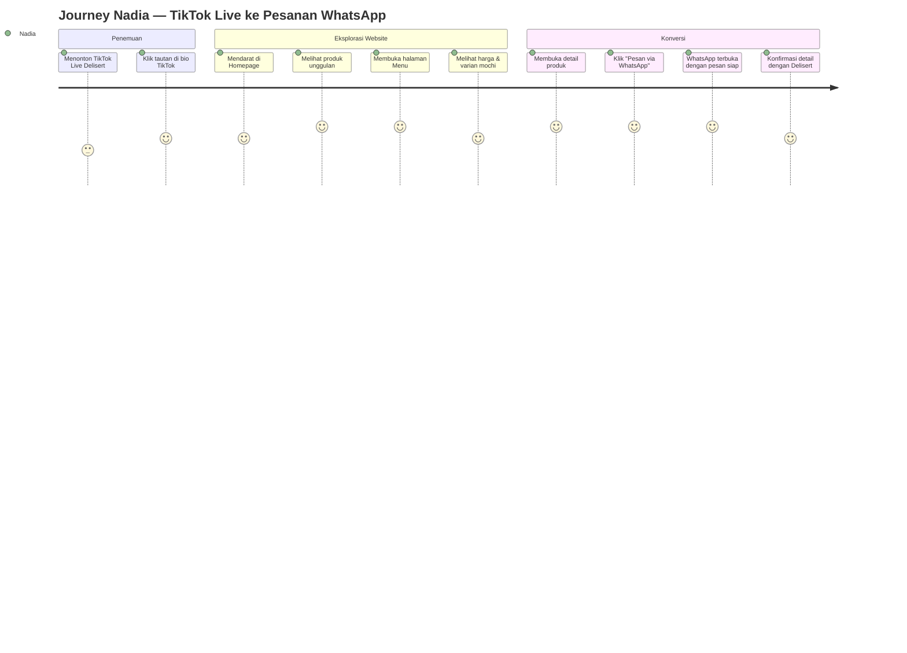
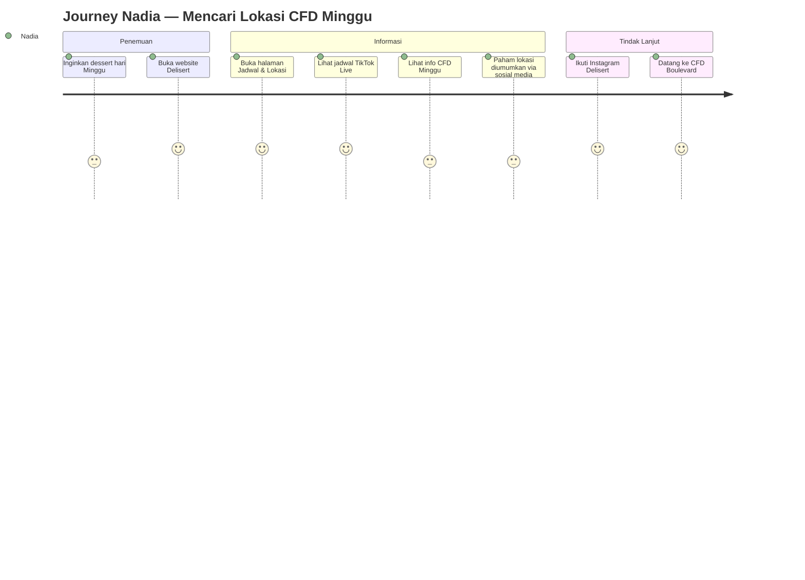
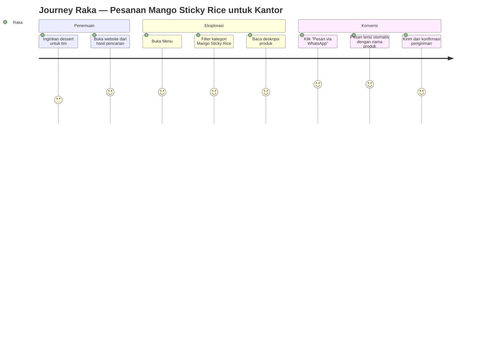
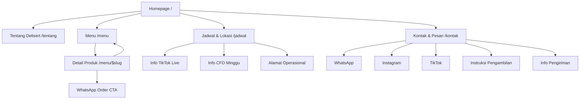
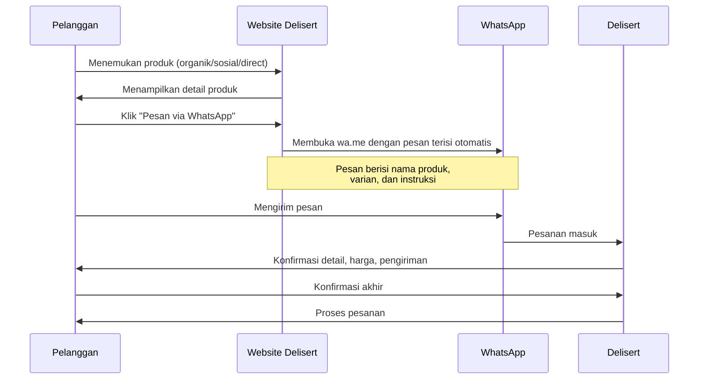
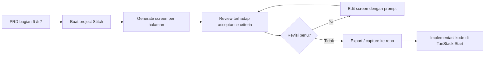
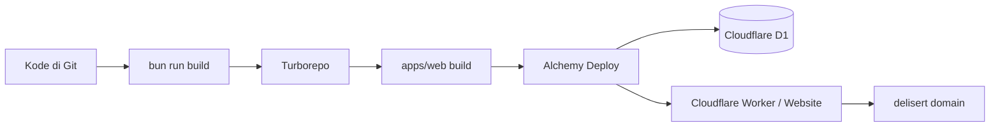
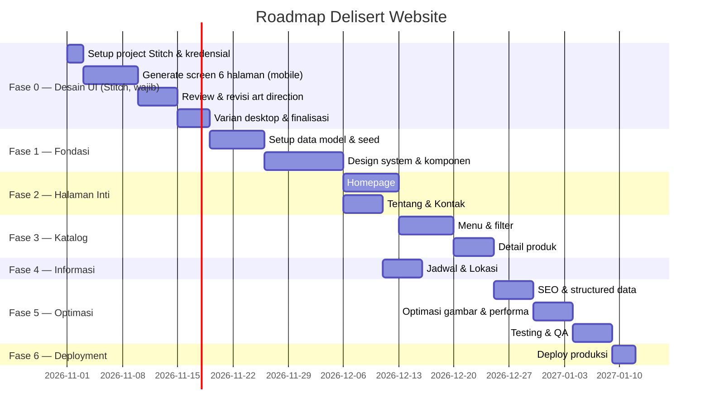

# Product Requirements Document (PRD)
## Delisert — Website Dessert & Homemade Food, Makassar

| Metadata | |
|---|---|
| **Nama Produk** | Website Delisert |
| **Kategori Bisnis** | Dessert & Homemade Food (UMKM) |
| **Lokasi** | Makassar, Sulawesi Selatan, Indonesia |
| **Versi Dokumen** | 1.2 |
| **Tanggal** | 30 Oktober 2026 |
| **Status** | MVP + Admin terimplementasi — menunggu review pemilik dan deploy |
| **Pemilik Dokumen** | Product / Engineering |
| **Sumber Kebenaran** | Dokumen ini adalah *single source of truth* untuk desain UI (Google Stitch, wajib) dan implementasi kode (Claude Code) |

---

## 1. Ringkasan Eksekutif

Delisert adalah bisnis dessert rumahan yang beroperasi di Makassar sejak 2021, dengan produk unggulan **Mochi**, **Pancake Durian**, **Mango Sticky Rice**, **Mille Crepes**, dan **Dubai Chewy Cookie**. Bisnis ini menjual secara *live selling* melalui TikTok Live pada hari Selasa–Sabtu, serta berjualan langsung pada aktivitas Car Free Day (CFD) setiap hari Minggu.

Website Delisert akan berfungsi sebagai **etalase digital premium** dan **platform pemasaran**, bukan sebagai sistem *e-commerce* penuh. Tujuan utamanya adalah:

1. Memperkenalkan Delisert kepada pelanggan baru secara profesional.
2. Menampilkan katalog produk dengan harga (ketika tersedia).
3. Mengomunikasikan jadwal TikTok Live dan aktivitas CFD Minggu.
4. Menyediakan informasi operasional, pengambalian pesanan, dan pengiriman.
5. Mengarahkan seluruh konversi ke **WhatsApp** untuk pemesanan.
6. Meningkatkan engagement Instagram dan TikTok.

**Keputusan arsitektural utama:** Tidak ada *checkout* atau pembayaran daring pada MVP. Seluruh pemesanan dialihkan ke WhatsApp dengan pesan terisi otomatis (*prefilled message*). Ini menghilangkan kebutuhan autentikasi, manajemen pembayaran, dan manajemen inventaris pada versi awal.

**Keputusan teknologi:** Stack sudah ditetapkan dan di-*scaffold* menggunakan Better-T-Stack (TanStack Start, tRPC, Drizzle ORM, Cloudflare D1, Bun, Turborepo). Dokumen ini menghormati stack tersebut dan tidak mengusulkan penggantian framework.

**Risiko terbesar:** Banyak informasi bisnis yang belum terkonfirmasi (harga produk, varian, foto asli, kode pos, sertifikasi halal). Dokumen ini menandai setiap informasi tersebut secara eksplisit dan **tidak mengarang data**. Lihat `docs/OPEN_QUESTIONS.md`.

---

## 2. Gambaran Bisnis

### 2.1 Informasi Terverifikasi (dari riset publik)

| Item | Nilai | Sumber |
|---|---|---|
| Nama bisnis | Delisert | Permintaan + profil Instagram |
| Nama tampilan Instagram | "MOCHI MOCHI• PANCAKE DURIAN • DESSERT MAKASSAR" | Instagram `@delisert.mks` |
| Kategori | Dessert & Homemade Food | Permintaan |
| Berdiri sejak | 2021 | Bio Instagram "Since 2021" |
| Pengikut Instagram | 5.517 | Instagram `@delisert.mks` |
| Pengikut Threads | 140 | Threads `@delisert.mks` |
| Klaim Halal | "100% HALAL" | Bio Instagram |
| Lokasi (bio) | "📍Toddopuli Raya Timur" | Instagram |
| WhatsApp | 085190021421 | Instagram + Threads |
| Google Maps | Terdaftar sebagai "DELISERT (MOCHI AND DESSERT)" | Bio Threads |
| Story Highlights | MANGGO STCKY RICE, MOCHI BEST, PANCAKE DURIAN, DUBAI CHEWY, MOCHI BIRTHDAY, Varian mochi, Small wholecake, CCTV DELISERT, Testi | Instagram |

### 2.2 Informasi dari Pemilik Bisnis (belum diverifikasi independen)

| Item | Nilai |
|---|---|
| Posisi merek | "Dessert Makassar" |
| Klaim merek | "Pelopor 1 Mochi di Jl. Boulevard" |
| Jadwal TikTok Live | Selasa–Sabtu, 10:30–14:30 WITA |
| Aktivitas Minggu | CFD Boulevard (berhadapan Social Barn) & CFD UNHAS (berhadapan Masjid UNHAS, area taman) |
| Hari Senin | Libur |
| Alamat operasional | Perumahan Villa Surya Mas, Cluster Harmonis 20, Jalan Toddopuli Raya Timur No. 20, RT.1/RW.24, Borong, Manggala, Makassar, Sulawesi Selatan |
| Kode pos | Tidak konsisten: 90233 atau 90234 (**perlu konfirmasi**) |
| Metode pengiriman | Gojek/GoSend, GrabExpress, Maxim, Shopee (layanan Shopee belum pasti) |
| Instruksi pengambilan | Sertakan nomor orderan (4 angka terakhir WA) |

### 2.3 Asumsi yang Digunakan dalam Dokumen Ini

> **A1.** Delisert adalah UMKM tanpa tim teknis internal. Website harus dapat dikelola oleh satu orang non-teknis setelah serah terima.
>
> **A2.** Mayoritas trafik berasal dari perangkat seluler melalui tautan Instagram/TikTok. Pendekatan *mobile-first* adalah prioritas.
>
> **A3.** Pelanggan sudah terbiasa memesan melalui WhatsApp. Alur "klik produk → WhatsApp terbuka dengan pesan siap" adalah pola yang dipahami pengguna.
>
> **A4.** Foto produk asli akan disediakan terpisah oleh pemilik bisnis. Desain harus adaptif terhadap aset nyata, bukan aset placeholder.
>
> **A5.** Klaim "Pelopor 1 Mochi di Jl. Boulevard" dan "100% HALAL" adalah klaim pemasaran yang disediakan bisnis. Klaim halal **tidak boleh** ditampilkan sebagai sertifikasi resmi sebelum dokumentasi diverifikasi.
>
> **A6.** Alamat operasional bukan toko ritel publik. Pengambilan pesanan di alamat tersebut belum dikonfirmasi boleh dilakukan pelanggan.

### 2.4 Informasi yang Hilang (Ringkasan)

Daftar lengkap ada di `docs/OPEN_QUESTIONS.md`. Ringkasan kritis:

- Logo resmi dan warna merek
- Foto produk asli
- Deskripsi produk
- Harga produk
- Varian produk
- Proses ketersediaan stok
- Jam pasti CFD Minggu
- Apakah kedua lokasi CFD aktif setiap Minggu
- Apakah alamat operasional menerima pengambilan pelanggan
- Kode pos yang benar (90233 / 90234)
- Layanan Shopee yang tepat
- Cakupan dan biaya pengiriman
- Sertifikasi/dokumentasi halal

---

## 3. Temuan Riset

Riset lengkap: `docs/BUSINESS_RESEARCH.md`.

### 3.1 Identitas Merek

**Temuan terverifikasi:**
- Nama tampilan Instagram menggabungkan tiga produk utama: Mochi, Pancake Durian, dan posisioning "Dessert Makassar". Ini menunjukkan produk Mochi adalah produk *anchor*.
- Story Highlights mengungkap lini produk yang lebih luas dari katalog awal: **Mochi Birthday**, **Small Wholecake**, dan **Varian Mochi** (beberapa varian rasa).
- Bio Threads menyebut "MOCHI MOCHI & MILLE CREPE CAKE MAKASSAR", mengonfirmasi Mille Crepes sebagai produk inti kedua.
- Terdaftar di Google Maps sebagai "DELISERT (MOCHI AND DESSERT)" — ini menandakan adanya kehadiran lokal yang sudah ditemukan pelanggan melalui pencarian peta.
- Highlight "Testi" menunjukkan bisnis mengumpulkan testimoni pelanggan.
- Highlight "CCTV DELISERT" menunjukkan transparansi operasional (kemungkinan untuk pengambilan pesanan).
- **Konfirmasi pemilik 2026-10-31:** lini "Small Wholecake" terwujud sebagai **Slice Cake** — 1 slice Rp 16.000 dengan tiga varian: Lotus Biscoff, Red Velvet, dan Coklat.

**Implikasi desain:**
- Mochi harus menjadi produk hero pada homepage.
- Kategori "Mochi" perlu sub-struktur varian rasa.
- Produk "Mochi Birthday" dan "Small Wholecake" adalah kategori bernilai tinggi yang layak mendapat penempatan khusus.
- Testimoni pelanggan adalah aset kepercayaan yang harus ditampilkan (ketika izin diperoleh).

### 3.2 Gaya Pemasaran

- Konten Instagram sebagian besar berupa *reels* pendek dan konten yang dibagikan ulang dari halaman rekomendasi kuliner Makassar.
- Promo bersifat musiman/batch, misalnya "PO Batch ke 2 Manggo sticky rice sold 110 porsi".
- Penjualan dikonsentrasikan pada TikTok Live — ini adalah kanal konversi utama, bukan website.
- Bahasa pemasaran berbahasa Indonesia informal dan antusias ("Warga makassarr buruan serbuuuuuu promo kita").

**Implikasi desain:**
- Website harus menjadi *brand anchor* yang tenang dan premium, berbeda dengan energi ramai media sosial. Website memberi kredibilitas; media sosial memberi konversi.
- Konsep "batch / PO (pre-order)" harus didukung pada model data produk — beberapa produk tidak selalu tersedia.

### 3.3 Keterbatasan Riset

| Platform | Status | Keterangan |
|---|---|---|
| Instagram | ✅ Berhasil diakses | Bio, pengikut, story highlights terbaca |
| Threads | ✅ Berhasil diakses | Bio, pengikut, beberapa caption terbaca |
| TikTok | ❌ Gagal | Kegagalan DNS (`ENOTFOUND www.tiktok.com`) dari lingkungan riset. Tidak ada data TikTok yang dapat diverifikasi. |
| Google Maps | ❌ Gagal | Halaman memerlukan JavaScript; data listing tidak ter-*render*. |
| Harga produk | ❌ Tidak ditemukan | Tidak ada harga yang terlihat di platform mana pun yang dapat diakses. |

**Tidak ada temuan riset yang dikarang.** Setiap klaim di atas berasal dari teks yang benar-benar terbaca pada sumber yang berhasil diakses.

---

## 4. Visi Produk

### 4.1 Pernyataan Visi

> Website Delisert adalah etalase digital premium yang memperkenalkan merek, menampilkan produk secara menggugah selera, mengomunikasikan jadwal penjualan dengan jelas, dan mengubah pengunjung menjadi pesanan WhatsApp — tanpa memerlukan sistem pembayaran daring.

### 4.2 Tujuan Utama

| # | Tujuan | Metrik Keberhasilan |
|---|---|---|
| G1 | Memperkenalkan Delisert kepada pelanggan baru | Trafik organik dari pencarian lokal Makassar |
| G2 | Menyajikan merek secara profesional dan kredibel | Tingkat *bounce* rendah pada halaman produk |
| G3 | Menampilkan katalog produk secara lengkap | Jumlah penayangan produk |
| G4 | Mengomunikasikan jadwal TikTok Live & CFD | Kunjungan berulang pada hari/jam penjualan |
| G5 | Mengarahkan pemesanan ke WhatsApp | Jumlah klik tombol WhatsApp |
| G6 | Meningkatkan engagement Instagram & TikTok | Jumlah klik ikon sosial |
| G7 | Membangun kepercayaan merek | Durasi kunjungan, kedalaman halaman |

### 4.3 Prinsip Desain Produk

1. **Konversi ke WhatsApp adalah metrik utama.** Setiap halaman harus memiliki jalur jelas ke WhatsApp.
2. **Mobile-first.** Desain untuk layar 375px terlebih dahulu.
3. **Editorial, bukan template restoran.** Tipografi elegan, ruang kosong luas, fotografi makanan yang dominan.
4. **Jujur pada ketersediaan.** Produk yang tidak tersedia ditandai jelas, tidak disembunyikan.
5. **Tidak ada klaim yang tidak terverifikasi.** Klaim halal, klaim "pelopor", dan jam operasional hanya ditampilkan sesuai status verifikasinya.
6. **Ringan.** UMKM dengan trafik musami; halaman harus cepat pada koneksi seluler Indonesia.

---

## 5. Target Audiens

### 5.1 Segmen Audiens

| Segmen | Karakteristik | Kebutuhan Utama |
|---|---|---|
| **Mahasiswa Makassar** | Usia 18–24, sensitif harga, aktif TikTok/Instagram, berkeliling CFD | Temukan dessert terjangkau, tahu lokasi CFD, lihat harga |
| **Dewasa Muda Profesional** | Usia 25–35, karyawan kantor, pesan untuk dibagi tim atau dibawa pulang | Pemesanan praktis via WhatsApp, tahu jam pengiriman |
| **Pecinta Dessert** | Mencari produk spesifik (mochi, mille crepes), mengikuti tren | Lihat varian lengkap, foto menarik, deskripsi rasa |
| **Keluarga** | Membeli untuk konsumsi bersama atau acara | Produk ukuran besar (wholecake), informasi pengiriman |
| **Pembeli Hadiah** | Mencari kue ulang tahun atau hampers | Kategori "Mochi Birthday" / "Small Wholecake", cara pre-order |
| **Pengikut Media Sosial** | Menemukan Delisert via TikTok/Instagram, ingin info lebih lanjut | Kredibilitas merek, jadwal live, tautan langsung |

### 5.2 Persona

#### Persona 1 — "Nadia, Mahasiswa UNHAS"

| Atribut | Detail |
|---|---|
| Usia | 20 tahun |
| Pekerjaan | Mahasiswa semester 4, UNHAS |
| Perangkat | iPhone 13, selalu pakai data seluler |
| Konteks | Melihat TikTok Live Delisert saat istirahat kuliah, ingin pesan tapi ragu |
| Tujuan | Cek harga mochi, tahu apakah bisa diambil di CFD UNHAS hari Minggu |
| Hambatan | Tidak yakin harga, tidak yakin lokasi, tidak mau chat WA kalau bisa lihat info dulu |
| Kebutuhan Website | Halaman harga transparan, jadwal CFD yang jelas, foto produk yang menggugah selera |

#### Persona 2 — "Raka, Karyawan Kantor"

| Atribut | Detail |
|---|---|
| Usia | 28 tahun |
| Pekerjaan | Staf administrasi, kantor di Pusat Kota Makassar |
| Perangkat | Android, browsing saat makan siang |
| Konteks | Ingin pesan mango sticky rice untuk dibagikan ke kantor besok |
| Tujuan | Lihat produk, pahami cara pesan, kirim pesan WA dengan cepat |
| Hambatan | Tidak mau mengisi form panjang, ingin langsung chat |
| Kebutuhan Website | Tombol WhatsApp yang jelas dengan pesan terisi otomatis, info pengiriman |

#### Persona 3 — "Sari, Ibu Rumah Tangga"

| Atribut | Detail |
|---|---|
| Usia | 34 tahun |
| Pekerjaan | Ibu rumah tangga, dua anak |
| Perangkat | Android, browsing malam hari |
| Konteks | Anak ulang tahun minggu depan, cari kue yang berbeda |
| Tujuan | Lihat pilihan wholecake/mochi birthday, pahami cara pre-order dan berapa lama |
| Hambatan | Tidak yakin produk tersedia, tidak yakin cara pesan untuk acara |
| Kebutuhan Website | Kategori produk acara, instruksi pre-order yang jelas, nomor WA yang mudah dihubungi |

### 5.3 User Journey

#### Journey 1 — Penemuan via TikTok Live (Nadia)



#### Journey 2 — Pencarian Lokasi Minggu (Nadia)



#### Journey 3 — Pesanan Kantor (Raka)



---

## 6. Arsitektur Informasi

### 6.1 Sitemap



### 6.2 Keputusan Arsitektur

| Keputusan | Alasan |
|---|---|
| **5 halaman utama** | Cukup untuk MVP; tidak perlu blog atau CMS |
| **Detail produk sebagai route terpisah** (`/menu/$slug`) | Mendukung SEO per produk, tautan yang dapat dibagikan, dan metadata Open Graph unik |
| **Tidak ada halaman checkout** | Seluruh konversi ke WhatsApp |
| **Tidak ada halaman login/akun** | Tidak ada autentikasi pada MVP |
| **Filter kategori pada /menu** | Lima kategori cukup untuk filter sederhana, bukan pencarian kompleks |
| **Halaman Jadwal terpisah dari Kontak** | Jadwal adalah informasi yang sering dicari; memisahkannya mengurangi beban kognitif |

### 6.3 Spesifikasi Halaman

#### A. Homepage (`/`)

| Urutan | Section | Isi | Prioritas |
|---|---|---|---|
| 1 | Navigasi | Logo, tautan: Tentang, Menu, Jadwal, Kontak. Tombol WhatsApp. Menu seluler. | MVP |
| 2 | Hero | Foto produk hero, headline merek, subheadline posisioning, CTA utama ke Menu, CTA sekunder ke WhatsApp | MVP |
| 3 | Brand Introduction | Pengenalan singkat Delisert, "Since 2021", posisioning | MVP |
| 4 | Produk Unggulan | 3–4 produk terbaik dengan foto, nama, harga (jika ada), CTA | MVP |
| 5 | Kategori Produk | 5 kategori dengan ikon/foto, tautan ke /menu | MVP |
| 6 | Cerita Merek | Ringkasan cerita merek, tautan ke /tentang | MVP |
| 7 | Jadwal TikTok Live | Selasa–Sabtu, 10:30–14:30 WITA, CTA "Follow Delisert on TikTok" | MVP |
| 8 | Info CFD Minggu | Penjelasan aktivitas Minggu, lokasi umum, arahan ke sosial media | MVP |
| 9 | Testimoni | Kutipan pelanggan (ketika izin diperoleh) | Future |
| 10 | Section Sosial Media | Ikon Instagram, TikTok, WhatsApp | MVP |
| 11 | Footer | Navigasi, kontak, alamat, jam, hak cipta | MVP |

**Catatan penting:** Jadwal TikTok Live **tidak boleh** menampilkan status "LIVE SEKARANG" kecuali ada integrasi status *real-time*. Tampilkan hanya jadwal statis.

#### B. Tentang Delisert (`/tentang`)

| Elemen | Isi |
|---|---|
| Header | Judul halaman, foto merek |
| Latar Belakang | Berdiri 2021, posisioning "Dessert Makassar" |
| Identitas Produk | Fokus pada Mochi sebagai produk anchor, plus lini dessert lainnya |
| Fotografi Merek | Foto asli dari pemilik bisnis |
| Nilai Merek | (Perlu konfirmasi dari pemilik) |

**Larangan:** Jangan mengarang kisah pendiri, penghargaan, atau pencapaian bisnis.

#### C. Menu / Katalog Produk (`/menu`)

| Elemen | Isi |
|---|---|
| Header | Judul, deskripsi singkat |
| Filter Kategori | Semua, Mochi, Pancake Durian, Mango Sticky Rice, Mille Crepes, Dubai Chewy Cookie, Slice Cake |
| Grid Produk | Kartu produk: foto, nama, kategori, harga (jika ada), badge ketersediaan |
| Empty State | Pesan ketika kategori tidak memiliki produk |
| CTA WhatsApp | Tombol mengambang atau per kartu |

Setiap kartu produk menampilkan:
- Nama produk
- Foto produk
- Deskripsi singkat
- Kategori
- Harga (ketika tersedia)
- Varian (ketika tersedia)
- Status ketersediaan
- CTA "Pesan via WhatsApp"

#### D. Detail Produk (`/menu/$slug`)

| Elemen | Isi |
|---|---|
| Galeri Foto | Foto produk utama + foto tambahan |
| Informasi | Nama, kategori, harga, varian, deskripsi lengkap |
| Ketersediaan | Status: Tersedia / Pre-Order / Habis |
| CTA WhatsApp | Tombol utama dengan pesan terisi otomatis menyertakan nama produk |
| Produk Terkait | 2–4 produk dari kategori yang sama |
| Breadcrumb | Menu / Kategori / Nama Produk |

#### E. Jadwal & Lokasi (`/jadwal`)

Section yang **wajib dipisahkan dengan jelas**:

**1. TikTok Live**
```
TikTok Live
Selasa – Sabtu
10:30–14:30 WITA
[Tombol: Follow Delisert on TikTok]
```

**2. Aktivitas CFD Minggu**
- Penjelasan: Delisert berjualan langsung setiap hari Minggu saat aktivitas Car Free Day.
- Titik penjualan yang diketahui:
  - CFD Boulevard — berhadapan Social Barn
  - CFD UNHAS — berhadapan Masjid UNHAS, area taman
- **Pernyataan wajib:** Titik penjualan ini bersifat sementara dan bukan cabang tetap. Jam operasional pastinya diumumkan melalui media sosial Delisert. Tidak ada jaminan kedua lokasi aktif setiap Minggu.

**3. Hari Senin**
```
Senin — Tutup / Libur
```

**4. Alamat Operasional**
```
Delisert Mochi and Dessert
Perumahan Villa Surya Mas, Cluster Harmonis 20,
Jalan Toddopuli Raya Timur No. 20,
RT.1/RW.24, Borong, Manggala,
Makassar, Sulawesi Selatan, Indonesia.
```
- **Larangan:** Jangan menampilkan jam buka toko permanen untuk alamat ini.
- **Larangan:** Jangan menyebut alamat ini sebagai "toko" atau "cabang" sebelum konfirmasi pemilik.
- Kode pos: tampilkan hanya setelah konfirmasi 90233 vs 90234.

#### F. Kontak & Pesan (`/kontak`)

| Elemen | Isi |
|---|---|
| WhatsApp | Nomor 085190021421, tombol chat langsung |
| Instagram | Tautan ke `@delisert.mks` |
| TikTok | Tautan ke `@delisert.mkss` |
| Instruksi Pengambilan | "Untuk memudahkan pengambilan pesanan, mohon sertakan nomor order atau 4 angka terakhir nomor WhatsApp yang digunakan saat memesan." |
| Informasi Pengiriman | Gojek/GoSend, GrabExpress, Maxim, Shopee — **sebagai opsi yang tunduk pada konfirmasi** |
| Alamat Operasional | Tautan ke section di /jadwal |

**Larangan:** Jangan meminta pelanggan menampilkan nomor WhatsApp lengkap secara publik. Jangan mengarang tarif, cakupan, atau estimasi waktu pengiriman.

### 6.4 Alur Pemesanan



**Tidak ada pembayaran daring. Tidak ada checkout otomatis. Tidak ada manajemen pesanan pada website.**

---

## 7. Arah UX/UI

> **KEPUTUSAN WAJIB — ALAT DESAIN:** Seluruh fase desain UI untuk website Delisert **wajib** menggunakan **Google Stitch melalui MCP server `@google/stitch`**. Nama project yang ditetapkan: **`delisert premium website ui design`**. Detail konfigurasi, alur kerja, dan batasannya ada di bagian 7.6.

### 7.1 Arah Visual

| Dimensi | Arah |
|---|---|
| **Kesan** | Premium dessert brand, editorial modern |
| **Fotografi** | Dominan, besar, berkualitas tinggi — foto makanan adalah hero |
| **Ruang kosong** | Luas, tidak padat |
| **Tipografi** | Elegan, hierarki jelas, satu *display font* + satu *body font* |
| **Warna** | **Belum ditentukan.** Menunggu logo dan aset merek asli |
| **Bentuk** | Konsisten, tidak berlebihan |
| **Animasi** | Halus dan terbatas — transisi, hover, reveal saat scroll |
| **Responsif** | Mobile-first, dioptimalkan untuk 375px ke atas |

### 7.2 Yang Harus Dihindari

- Template restoran generik
- Layout khas AI-generated
- Gradien berlebihan
- Glassmorphism berlebihan
- Kartu dengan sudut membulat di mana-mana
- Animasi berlebihan
- Dekorasi yang tidak perlu

### 7.3 Strategi Warna

Warna resmi **belum dapat ditentukan** sebelum logo dan foto produk asli ditinjau. Dokumen ini mendefinisikan strategi, bukan nilai final:

1. **Warna dasar netral** (putih/krem/off-white) sebagai kanvas agar fotografi makanan dominan.
2. **Warna aksen** diturunkan dari logo Delisert ketika tersedia.
3. **Warna pendukung** untuk badge ketersediaan (tersedia / pre-order / habis) — harus dapat dibedakan tanpa mengandalkan warna saja.
4. **Kontras** harus memenuhi WCAG AA (minimal 4.5:1 untuk teks normal).

**Catatan teknis:** Scaffold saat ini menggunakan token warna netral (grayscale) di `packages/ui/src/styles/globals.css` dengan dukungan mode gelap. Token ini harus diganti dengan palet merek Delisert setelah aset disetujui. Root route saat ini memaksa `className="dark"` pada `<html>` — ini harus diubah menjadi pengambilan tema yang sesuai (mungkin default terang untuk brand makanan).

### 7.4 Sistem Komponen

Komponen yang tersedia di `packages/ui` saat ini:
`attachment, bubble, button, card, checkbox, dropdown-menu, empty, input-group, input, label, marker, message-scroller, message, skeleton, sonner, textarea, tooltip`

Komponen yang perlu ditambahkan untuk Delisert:
- `ProductCard` — kartu produk katalog
- `ProductGallery` — galeri foto produk
- `WhatsAppButton` — tombol CTA WhatsApp dengan pesan terisi
- `ScheduleCard` — kartu jadwal (TikTok Live / CFD / Senin)
- `SocialLinks` — tautan Instagram/TikTok/WhatsApp
- `SectionHeading` — heading section konsisten
- `AvailabilityBadge` — badge status ketersediaan
- `NavBar` / `MobileNav` — navigasi responsif

### 7.5 Aksesibilitas

| Persyaratan | Detail |
|---|---|
| Kontras warna | WCAG AA minimum (4.5:1 teks normal, 3:1 teks besar) |
| Navigasi keyboard | Semua elemen interaktif dapat diakses via Tab, urutan logis |
| Focus indicator | Indikator fokus yang terlihat jelas |
| Alt text | Semua foto produk dan foto merek memiliki alt deskriptif |
| Struktur heading | Satu `<h1>` per halaman, hierarki heading tidak dilewati |
| Bahasa | `lang="id"` pada `<html>` (saat ini `lang="en"`) |
| Label formulir | Semua input memiliki label yang terasosiasi |
| Status ketersediaan | Tidak hanya warna — sertakan teks/ikon |

### 7.6 Wajib: Desain UI via Google Stitch (MCP)

#### 7.6.1 Keputusan

| Atribut | Nilai |
|---|---|
| **Alat desain** | Google Stitch (generasi UI berbasis Gemini) |
| **Cara akses** | MCP server resmi `@google/stitch` (repo `google-labs-code/stitch-sdk`) |
| **Nama project** | `delisert premium website ui design` |
| **Status** | **Wajib** — bukan opsional, bukan alternatif |
| **Ruang lingkup** | Homepage, Tentang, Menu, Detail Produk, Jadwal & Lokasi, Kontak |
| **Sumber kebenaran desain** | Dokumen ini (PRD) adalah *art-direction brief* untuk Stitch |

Dokumen ini adalah **single source of truth**. Stitch menerima arahan dari dokumen ini; Stitch tidak menggantikan keputusan yang sudah ditetapkan di sini (misalnya warna merek yang masih menunggu aset asli, atau larangan menampilkan harga palsu).

#### 7.6.2 Konfigurasi MCP (sudah diterapkan)

Entri `stitch` sudah ditambahkan ke `.mcp.json` di root repository:

```json
{
  "mcpServers": {
    "stitch": {
      "command": "npx",
      "args": ["-y", "@google/stitch@latest", "mcp", "start"],
      "env": {
        "STITCH_API_KEY": "${STITCH_API_KEY}",
        "STITCH_PROJECT_ID": "${STITCH_PROJECT_ID:-delisert premium website ui design}"
      }
    }
  }
}
```

Aturan konfigurasi:

1. **API key tidak pernah ditulis langsung di `.mcp.json`.** `.mcp.json` dilacak git; menuliskan key di sana akan meng-commit rahasia. Key disimpan di `.env` (sudah masuk `.gitignore` baris 17) dan dibaca lewat ekspansi `${STITCH_API_KEY}`.
2. **Versi paket dipin ke `@latest`** agar mendapatkan fitur terbaru; jika diperlukan reproduktibilitas, pin ke versi eksplisit (misal `@google/stitch@0.12.1`).
3. **Persyaratan runtime:** Node.js 20 atau lebih baru. Paket hanya bergantung pada `zod`.
4. **Verifikasi koneksi:** jalankan `claude mcp list` dan pastikan server `stitch` terdaftar serta terhubung.
5. **Bentuk perintah wajib `mcp start`.** Paket `@google/stitch` tidak mengenal sub-perintah `stitch-mcp`. Jika argumen itu dipakai, proses langsung keluar dengan `UNKNOWN_COMMAND` dan MCP client menampilkan `Failed to reconnect to stitch: CONNECTION_CLOSED`. Perbaikan: ganti argumen menjadi `["-y", "@google/stitch@latest", "mcp", "start"]`.
6. **Server mungkin berstatus "Pending approval"** setelah `.mcp.json` diubah. Jalankan `/mcp` lalu setujui server `stitch` agar aktif di sesi berjalan.

#### 7.6.3 Cara project di Stitch

`STITCH_PROJECT_ID` pada dasarnya adalah **ID numerik** project di canvas Stitch, bukan nama tampilan. Nama `delisert premium website ui design` adalah judul project yang diminta. Urutan langkah:

1. Buat project dengan judul tersebut:
   ```bash
   npx @google/stitch create project --title "delisert premium website ui design"
   ```
2. Ambil ID numeriknya:
   ```bash
   npx @google/stitch find projects --json
   ```
3. Simpan ID itu ke `.env`:
   ```
   STITCH_PROJECT_ID=<id-numerik>
   ```
4. Verifikasi:
   ```bash
   npx @google/stitch get project <id-numerik> --json
   ```

**Status saat ini (dikonfirmasi pemilik proyek 2026-10-30):** project kanonik adalah `5848136313735450963`, berjudul "Delisert Premium Website UI Design", dengan `designTheme` "Haute Pâtisserie & Artisanal Deli" dan 22 screen (10 DESKTOP terstruktur + 12 screenshot referensi). ID tersebut sudah tercatat di `.env` dan tidak perlu diubah. Ada juga project kedua berjudul sama dengan huruf kecil (`8435499262000866002`) yang masih kosong (0 screen) — tidak dipakai agar desain tidak terpecah.

#### 7.6.4 Alur Kerja Desain yang Wajib



Aturan alur:

1. **Satu screen per halaman** sesuai sitemap di bagian 6.1 — enam halaman MVP.
2. **Perangkat MOBILE lebih dulu** (mobile-first, sesuai NFR dan asumsi A-02 bahwa trafik didominasi seluler), kemudian varian `DESKTOP`.
3. **Prompt art-direction harus merujuk bagian ini**, bukan dikarang bebas. Elemen yang wajib masuk prompt: kesan premium editorial, fotografi makanan dominan, ruang kosong luas, tipografi elegan, tanpa gradien berlebihan, tanpa glassmorphism berlebihan.
4. **Varian eksplorasi** diperbolehkan untuk menemukan arah visual, dengan batas `--creative-range EXPLORE` dan `--count` 2–3 agar tidak membuang kuota.
5. **Warna merek tidak boleh diputuskan oleh Stitch** sebelum logo dan foto produk asli diterima (Q-01, Q-02, Q-03). Selama belum ada, gunakan arah netral hangat dari bagian 7.3.
6. **Harga tidak boleh muncul sebagai angka** di desain mana pun selama Q-04 belum terjawab. Gunakan pola "Hubungi untuk harga".
7. **Tidak ada klaim yang belum terverifikasi** di desain: sertifikasi halal (Q-11), klaim "Pelopor" (Q-14), jam CFD pasti (Q-09), dan status kedua titik CFD aktif setiap Minggu (Q-10).
8. **Setiap screen yang disetujui** harus dicatat di `docs/OPEN_QUESTIONS.md` atau dokumen desain terpisah sebagai artefak yang dapat ditelusuri.

#### 7.6.5 Perintah Referensi

| Tujuan | Perintah |
|---|---|
| Buat project | `npx @google/stitch create project --title "delisert premium website ui design"` |
| Generate screen | `npx @google/stitch generate screen --project <id> --prompt "<art direction>" --device MOBILE` |
| Generate varian | `npx @google/stitch generate variants --project <id> --screen <screen-id> --count 3 --creative-range EXPLORE` |
| Edit screen | `npx @google/stitch edit screen <screen-id> --project <id> --prompt "<perubahan>"` |
| Terapkan design system | `npx @google/stitch edit screen <screen-id> --project <id> --design-system <ds-id>` |
| Daftar screen | `npx @google/stitch find screen --project <id> --json` |
| Preview lokal | `npx @google/stitch serve -p <id> --port 3000` |
| Buka di canvas | `npx @google/stitch open project <id>` |
| Ambil halaman app yang sudah jalan | `npx @google/stitch capture http://localhost:3001/<route>` lalu `npx @google/stitch upload screen <file> --route /<route>` |

Setiap perintah menerima `--json` untuk keluaran terstruktur dan `--schema` untuk melihat skema payload — berguna saat dipakai dari agent.

#### 7.6.6 Batasan yang Perlu Diketahui

| Batasan | Dampak | Penanganan |
|---|---|---|
| Beberapa operasi Canvas butuh `STITCH_API_KEY` meski sudah OAuth | Perintah gagal dengan `MISSING_CANVAS_CREDENTIALS` | Key sudah disediakan di `.env` |
| Fitur **Loop** masih eksperimental | API dan flag bisa berubah tanpa versi mayor | Jangan dipakai untuk produksi MVP |
| Stitch tidak tahu harga, foto, atau varian asli | Desain bisa mengundang data palsu | Bagian 7.6.4 aturan 5–7 mengunci ini |
| ID project numerik wajib untuk sebagian besar perintah | Perintah gagal jika hanya pakai nama | Ikuti urutan 7.6.3 |
| Output Stitch adalah desain, bukan kode produksi | Perlu implementasi manual di TanStack Start | Stitch menjadi brief visual; kode ditulis mengikuti stack yang ditetapkan |
| **`--device MOBILE` tidak menjamin lebar kanvas 780 px** | Render bisa keluar 2560 px walau respons API melaporkan `"width": "780"` | Ukur PNG hasil unduh dengan `ffprobe`; sisipkan larangan lebar eksplisit di prompt; kalau CLI tetap gagal berulang, ulangi lewat MCP tool `stitch_generate` (terbukti berhasil saat CLI gagal 5×) |
| Varian MOBILE belum tentu terindeks di `stitch find screens` | ID screen tidak bisa dipakai untuk langkah lanjutan | Simpan ID **file** (`files/<id>:download`) sebagai artefak; lihat `docs/DESIGN_AUDIT.md` §7 |
| `stitch_edit` MCP gagal pada screen yang baru dibuat | `RESOURCE_NOT_FOUND` karena indeks belum terbarui | Pakai CLI `npx @google/stitch edit screen <screen-id> --project <id> --prompt "..."` |

#### 7.6.7 Definisi Selesai — Fase Desain

Fase desain dianggap selesai ketika:

1. Enam halaman MVP memiliki screen di project `delisert premium website ui design`.
2. Setiap screen varian MOBILE dan DESKTOP telah ditinjau terhadap bagian 6.3 dan 7.1–7.5.
3. Tidak ada angka harga, klaim belum terverifikasi, atau jam CFD pasti yang muncul di desain.
4. Palet warna final telah ditetapkan **jika** logo/foto sudah diterima; jika belum, arah netral hangat digunakan dan ditandai sebagai sementara.
5. Daftar screen beserta ID-nya dicatat sebagai artefak proyek.
6. Tim implementasi memiliki brief visual yang cukup untuk membangun komponen di bagian 7.4.

**Status per 2026-10-31 (6 halaman DESKTOP + 5 varian MOBILE):**

| Kriteria | Status |
|---|---|
| 1. Enam halaman MVP punya screen | ✅ 6 DESKTOP + 6 MOBILE |
| 2. Screen ditinjau terhadap 6.3 & 7.1–7.5 | ✅ DESKTOP lengkap; MOBILE 6/6 |
| 3. Bebas harga karangan & klaim belum terverifikasi | ✅ semua screen publik sudah dikoreksi dan diverifikasi visual |
| 4. Palet final | 🔶 arah netral hangat "Haute Pâtisserie" dipakai, masih menunggu logo/foto asli (Q-01, Q-02, Q-03) |
| 5. ID tercatat sebagai artefak | ✅ `docs/DESIGN_AUDIT.md` §1 dan §7 |
| 6. Brief visual cukup | ✅ keenam halaman |

**Sisa untuk menuntaskan fase desain:** varian DESKTOP (opsional, karena screen DESKTOP asli sudah
ada dan sudah bersih), plus keputusan pemilik atas Q-29 (kunci API kanonik), Q-30 (harga Mille
Crepes), dan harga contoh di Admin Katalog & Stok.

---

## 8. Kebutuhan Fungsional

Sumber lengkap dengan acceptance criteria: `docs/PRODUCT_REQUIREMENTS.md`.

### 8.1 Ringkasan Kebutuhan MVP

| ID | Nama | Prioritas |
|---|---|---|
| FR-001 | Homepage dengan section lengkap | MVP |
| FR-002 | Halaman Tentang Delisert | MVP |
| FR-003 | Katalog produk dengan filter kategori | MVP |
| FR-004 | Detail produk individual | MVP |
| FR-005 | Pemesanan via WhatsApp dengan pesan terisi | MVP |
| FR-006 | Tautan media sosial | MVP |
| FR-007 | Tampilan jadwal TikTok Live | MVP |
| FR-008 | Tampilan info CFD Minggu | MVP |
| FR-009 | Tampilan alamat operasional | MVP |
| FR-010 | Instruksi pengambilan pesanan | MVP |
| FR-011 | Informasi metode pengiriman | MVP |
| FR-012 | Navigasi responsif | MVP |
| FR-013 | Metadata SEO dasar | MVP |
| FR-014 | Sitemap & robots.txt | MVP |
| FR-015 | Halaman Jadwal & Lokasi | MVP |
| FR-016 | Halaman Kontak & Pesan | MVP |

### 8.2 Kebutuhan Future (Non-MVP)

| ID | Nama | Prioritas |
|---|---|---|
| FR-101 | Dashboard admin | Future |
| FR-102 | Manajemen produk | Future |
| FR-103 | Manajemen promosi | Future |
| FR-104 | Inventaris produk | Future |
| FR-105 | Manajemen pesanan otomatis | Future |
| FR-106 | Pembayaran daring | Future |
| FR-107 | Testimoni pelanggan terkurasi | Future |
| FR-108 | Integrasi status TikTok Live real-time | Future |
| FR-109 | Notifikasi stok / restock | Future |

---

## 9. Kebutuhan Non-Fungsional

| ID | Kategori | Persyaratan |
|---|---|---|
| NFR-001 | Performa | LCP < 2.5s pada koneksi 4G, perangkat seluler kelas menengah |
| NFR-002 | Performa | Total halaman < 500KB (tanpa menghitung foto, yang harus dioptimalkan) |
| NFR-003 | Gambar | Semua foto produk menggunakan format modern (WebP/AVIF) dengan fallback |
| NFR-004 | Gambar | Responsive images dengan `srcset` untuk berbagai ukuran layar |
| NFR-005 | Gambar | Lazy loading untuk foto di bawah fold |
| NFR-006 | SEO | Metadata unik per halaman (title, description) |
| NFR-007 | SEO | Open Graph tags untuk berbagi media sosial |
| NFR-008 | SEO | Sitemap.xml dan robots.txt |
| NFR-009 | SEO | Structured data (JSON-LD) untuk LocalBusiness dan Product |
| NFR-010 | SEO | URL yang bersih dan deskriptif (`/menu/mochi-matcha`) |
| NFR-011 | Aksesibilitas | WCAG 2.1 Level AA |
| NFR-012 | Kompatibilitas | Browser modern 2 versi terakhir (Chrome, Safari, Firefox, Edge) |
| NFR-013 | Kompatibilitas | iOS Safari dan Android Chrome sebagai prioritas |
| NFR-014 | Bahasa | Bahasa Indonesia sebagai bahasa utama |
| NFR-015 | Deployment | Cloudflare Workers via Alchemy |
| NFR-016 | Maintainability | Pemilik bisnis dapat memperbarui konten tanpa mengubah kode (target pasca-MVP) |

---

## 10. Arsitektur Teknis

Sumber lengkap: `docs/TECHNICAL_ARCHITECTURE.md`.

### 10.1 Stack yang Ditetapkan (Tidak Berubah)

| Komponen | Teknologi | Versi/Terlihat di |
|---|---|---|
| Scaffold | Better-T-Stack | v3.49.0 (`bts.jsonc`) |
| Frontend | TanStack Start + TanStack Router | `^1.169.1` / `^1.170.44` |
| UI | React 19 + TailwindCSS 4 + shadcn/ui | `^19.3.0` / `^4.3.3` |
| API | tRPC v11 | `^11.19.0` |
| ORM | Drizzle ORM | `packages/db` |
| Database | Cloudflare D1 (SQLite) | `packages/db/drizzle.config.ts` |
| Package Manager | Bun | `bun@1.4.4` |
| Monorepo | Turborepo | `^2.11.7` |
| Deployment | Cloudflare via Alchemy | `packages/infra/alchemy.run.ts` |
| Env | Varlock | `1.23.0` |
| MCP | Better-T-Stack MCP addon | `.mcp.json` |
| **Desain UI (wajib)** | **Google Stitch via MCP `@google/stitch`** | **`.mcp.json` — lihat bagian 7.6** |

**Tidak ada autentikasi. Tidak ada pembayaran. Tidak ada backend runtime terpisah.**

### 10.2 Struktur Folder (Berdasarkan Scaffold Aktual)

```
delisert.mks-1/
├── apps/
│   └── web/                          # Aplikasi fullstack (React + TanStack Start)
│       ├── public/
│       │   └── robots.txt            # Sudah ada — perlu diperluas
│       └── src/
│           ├── components/           # Komponen spesifik app (header.tsx, loader.tsx)
│           ├── routes/
│           │   ├── __root.tsx        # Root route — perlu diubah (lang, tema, meta)
│           │   ├── index.tsx         # Homepage — perlu ditulis ulang total
│           │   └── api/trpc/$.ts     # tRPC endpoint — sudah ada
│           ├── utils/trpc.ts         # tRPC client hooks — sudah ada
│           ├── services.ts           # getDb() — sudah ada
│           ├── router.tsx            # Router setup — sudah ada
│           ├── context.ts            # tRPC context — sudah ada
│           ├── env.ts / env.server.ts# Env (autogenerated)
│           └── index.css
├── packages/
│   ├── api/
│   │   └── src/
│   │       ├── index.ts              # initTRPC — sudah ada
│   │       ├── context.ts            # { db } — sudah ada
│   │       └── routers/
│   │           └── index.ts          # appRouter — perlu diperluas
│   ├── db/
│   │   └── src/
│   │       ├── config.ts             # DatabaseConfig { DB: D1Database } — sudah ada
│   │       ├── index.ts              # createDb() — sudah ada
│   │       ├── relations.ts          # defineRelations — sudah ada
│   │       ├── schema/
│   │       │   └── index.ts          # KOSONG — perlu diisi
│   │       └── migrations/           # KOSONG — perlu generate
│   ├── ui/                           # Komponen shadcn bersama
│   │   └── src/
│   │       ├── components/           # 16 komponen tersedia
│   │       ├── styles/globals.css    # Token warna netral — perlu palet merek
│   │       └── lib/utils.ts
│   ├── config/                       # tsconfig dasar
│   └── infra/
│       └── alchemy.run.ts            # D1 + Website.Vite — sudah ada
├── docs/                             # Dokumentasi PRD (dokumen ini)
├── bts.jsonc                         # Metadata stack
├── turbo.json
└── package.json
```

### 10.3 Route yang Perlu Dibuat

| Route | File | Status |
|---|---|---|
| `/` | `apps/web/src/routes/index.tsx` | Perlu ditulis ulang |
| `/tentang` | `apps/web/src/routes/tentang.tsx` | Baru |
| `/menu` | `apps/web/src/routes/menu.tsx` | Baru |
| `/menu/$slug` | `apps/web/src/routes/menu/$slug.tsx` | Baru |
| `/jadwal` | `apps/web/src/routes/jadwal.tsx` | Baru |
| `/kontak` | `apps/web/src/routes/kontak.tsx` | Baru |
| `/api/trpc/$` | `apps/web/src/routes/api/trpc/$.ts` | Sudah ada |

### 10.4 Arsitektur API (tRPC)

Router saat ini hanya memiliki `healthCheck`. Router yang diperlukan:

```typescript
// packages/api/src/routers/index.ts (target)
export const appRouter = router({
  healthCheck: publicProcedure.query(() => "OK"),

  product: router({
    list: publicProcedure
      .input(z.object({ category: z.string().optional() }).optional())
      .query(({ ctx, input }) => /* daftar produk */),
    bySlug: publicProcedure
      .input(z.object({ slug: z.string() }))
      .query(({ ctx, input }) => /* detail produk */),
    categories: publicProcedure
      .query(({ ctx }) => /* daftar kategori */),
  }),

  schedule: router({
    all: publicProcedure.query(({ ctx }) => /* jadwal + lokasi + alamat */),
  }),
});
```

**Catatan:** Karena data bisnis relatif statis dan volume kecil, pertimbangkan apakah data sebaiknya disimpan di D1 atau sebagai konstanta terstruktur di kode. Lihat keputusan di §10.7.

### 10.5 Model Data

Detail lengkap: `docs/TECHNICAL_ARCHITECTURE.md` §5.

Ringkasan entitas:

| Entitas | Tujuan | Prioritas |
|---|---|---|
| `product_categories` | Kategori produk (Mochi, Pancake Durian, dst.) | MVP |
| `products` | Produk individual | MVP |
| `product_variants` | Varian rasa/ukuran per produk | MVP |
| `selling_schedules` | Jadwal TikTok Live & CFD | MVP |
| `selling_locations` | Titik penjualan CFD (sementara) | MVP |
| `operational_address` | Alamat operasional | MVP |
| `delivery_methods` | Metode pengiriman | MVP |
| `social_media` | Tautan sosial | MVP |
| `promotions` | Promosi/batch PO | Future |

### 10.6 Deployment



Perintah deployment:
```bash
# Development
bun run dev              # http://localhost:3001

# Production (dari packages/infra)
cd packages/infra && bunx alchemy deploy --stage production
```

**Catatan:** `alchemy.run.ts` sudah memprovisikan D1 database dan Website.Vite dengan binding `DB`. Migrasi Drizzle diterapkan saat deploy.

### 10.7 Keputusan: Database vs. Konstanta Kode

**Rekomendasi:** Gunakan **pendekatan hibrida**.

| Data | Lokasi | Alasan |
|---|---|---|
| Kategori produk | **Konstanta kode** (`packages/api/src/data/categories.ts`) | 5 kategori, jarang berubah |
| Produk & varian | **D1 Database** | Perlu dapat diperbarui, mendukung slug dinamis |
| Jadwal TikTok Live | **Konstanta kode** | Sangat jarang berubah |
| Lokasi CFD | **Konstanta kode** | Diubah via deploy, bukan via CMS |
| Alamat operasional | **Konstanta kode** | Sangat jarang berubah |
| Metode pengiriman | **Konstanta kode** | Sangat jarang berubah |
| Tautan sosial | **Konstanta kode** | Sangat jarang berubah |

**Alasan:** Sebagian besar konten Delisert bersifat statis dan dimiliki oleh pemilik bisnis non-teknis. Menyimpan semuanya di database menambah kompleksitas migrasi, seeding, dan UI admin tanpa manfaat nyata pada MVP. Produk masuk database karena katalog akan tumbuh dan perlu dikelola lebih fleksibel.

**Alternatif yang ditolak:** Menyimpan semua di database memerlukan admin dashboard (FR-101) yang eksplisit ditunda ke Future.

### 10.8 Konfigurasi Environment

Schema env saat ini hanya mendefinisikan `NODE_ENV`. Variabel yang mungkin diperlukan:

| Variabel | Tipe | Sensitif | Keterangan |
|---|---|---|---|
| `NODE_ENV` | enum | Tidak | Sudah ada |
| `WHATSAPP_NUMBER` | string | Tidak | Nomor WA bisnis (format internasional: 6285190021421) |
| `SITE_URL` | string | Tidak | URL produksi untuk metadata/OG |
| `INSTAGRAM_URL` | string | Tidak | Tautan Instagram |
| `TIKTOK_URL` | string | Tidak | Tautan TikTok |
| `ANALYTICS_ID` | string | Tidak | ID analytics (jika digunakan) |

**Catatan:** Schema env dikelola Varlock. Setelah mengubah `apps/web/.env.schema`, jalankan `bun run env:generate`.

---

## 11. SEO, Performa, dan Aksesibilitas

### 11.1 Strategi SEO Lokal

Target: pelanggan di Makassar yang mencari "dessert Makassar", "mochi Makassar", "pancake durian Makassar", "mille crepes Makassar".

| Elemen | Implementasi |
|---|---|
| Title tag | "Delisert — Mochi & Dessert Makassar \| Sejak 2021" |
| Meta description | Menyertakan lokasi Makassar dan produk utama |
| Structured data | `LocalBusiness` (nama, alamat, area served, jam) + `Product` (nama, harga, ketersediaan) |
| Hreflang | `id-ID` |
| Heading | Satu `<h1>` per halaman, menyertakan kata kunci lokal |
| Alt text | Deskriptif, menyertakan nama produk dan "Makassar" bila relevan |

### 11.2 Open Graph

| Properti | Nilai |
|---|---|
| `og:title` | Judul halaman |
| `og:description` | Deskripsi halaman |
| `og:image` | Foto produk/merek (1200×630px) |
| `og:type` | `website` (homepage), `product` (detail produk) |
| `og:locale` | `id_ID` |
| `twitter:card` | `summary_large_image` |

### 11.3 Core Web Vitals

| Metrik | Target | Strategi |
|---|---|---|
| LCP | < 2.5s | Optimasi foto hero, preload foto utama, SSR |
| INP | < 200ms | Minimalkan JavaScript client-side, gunakan SSR |
| CLS | < 0.1 | Dimensi foto eksplisit (width/height), reserved space |

### 11.4 Optimasi Gambar

- Format WebP/AVIF dengan fallback
- `srcset` untuk 1x/2x dan berbagai breakpoint
- `loading="lazy"` untuk foto di bawah fold
- `fetchpriority="high"` untuk foto hero
- Dimensi eksplisit pada setiap `` untuk mencegah CLS
- Kompresi target: < 200KB per foto produk

---

## 12. Analitik dan Metrik Keberhasilan

### 12.1 KPI

| KPI | Definisi | Target Awal |
|---|---|---|
| Pengunjung website | Sesi unik per bulan | Baseline bulan 1 |
| Penayangan produk | View halaman detail produk | > 40% dari sesi |
| Klik WhatsApp | Klik tombol CTA WhatsApp | > 8% dari sesi |
| Klik Instagram | Klik tautan Instagram | > 3% dari sesi |
| Klik TikTok | Klik tautan TikTok | > 3% dari sesi |
| Produk paling dilihat | Peringkat produk | Insight katalog |
| Rasio mobile/desktop | Perangkat pengunjung | Ekspektasi > 85% mobile |
| Trafik organik | Dari mesin pencari | Pertumbuhan bulanan |

### 12.2 Rekomendasi Analitik

**Solusi ringan yang direkomendasikan untuk UMKM:**

| Opsi | Kelebihan | Kekurangan |
|---|---|---|
| **Cloudflare Web Analytics** | Gratis, tanpa cookie, tanpa consent banner, sudah terintegrasi dengan deployment Cloudflare | Terbatas pada data Cloudflare |
| **Umami** | Open source, privacy-focused, self-hosted | Perlu hosting terpisah |
| **Plausible** | Ringan, privacy-focused | Berbayar untuk volume tertentu |
| **Google Analytics 4** | Gratis, lengkap | Perlu consent banner (GDPR/UU PDP), berat |

**Rekomendasi:** Cloudflare Web Analytics untuk MVP. Ini tidak memerlukan consent banner, tidak menambah beban JavaScript, dan sudah terintegrasi dengan stack deployment.

**Pelacakan event khusus** (klik WhatsApp, klik sosial) dapat dilakukan dengan menambahkan atribut `data-*` pada tombol dan event listener sederhana, atau menunggu solusi analitik yang lebih lengkap.

---

## 13. MVP dan Roadmap

### 13.1 Ruang Lingkup MVP

| # | Item | Status |
|---|---|---|
| 1 | Homepage lengkap | MVP |
| 2 | Halaman Tentang | MVP |
| 3 | Katalog produk + filter kategori | MVP |
| 4 | Detail produk | MVP |
| 5 | Halaman Jadwal & Lokasi | MVP |
| 6 | Halaman Kontak & Pesan | MVP |
| 7 | Pemesanan via WhatsApp (pesan terisi) | MVP |
| 8 | Tautan media sosial | MVP |
| 9 | Instruksi pengambilan | MVP |
| 10 | Informasi pengiriman | MVP |
| 11 | Desain responsif | MVP |
| 12 | SEO dasar (meta, OG, sitemap, robots) | MVP |
| 13 | Structured data (LocalBusiness, Product) | MVP |
| 14 | Optimasi gambar | MVP |

**Tidak termasuk dalam MVP:**
- Dashboard admin
- Manajemen produk via UI
- Manajemen promosi
- Inventaris
- Manajemen pesanan otomatis
- Pembayaran daring
- Testimoni terkurasi
- Integrasi TikTok Live real-time
- Blog / konten

### 13.2 Roadmap



**Catatan Fase 0:** Fase desain Stitch bersifat **wajib dan berurutan sebelum implementasi kode**. Referensi lengkap perintah dan batasannya ada di bagian 7.6. Fase 0 dapat berjalan paralel dengan Fase 1 (data model tidak bergantung pada desain), tetapi implementasi halaman (Fase 2 ke atas) tidak boleh dimulai sebelum screen disetujui.

### 13.3 Fase Setelah MVP

| Fase | Item | Prasyarat |
|---|---|---|
| Fase 2 | Dashboard admin sederhana | Data model stabil, pemilik bisnis siap mengelola |
| Fase 2 | Manajemen produk via UI | Dashboard admin |
| Fase 2 | Testimoni pelanggan | Izin dari pelanggan |
| Fase 3 | Manajemen promosi/batch PO | Dashboard admin |
| Fase 3 | Notifikasi restock | Inventaris |
| Fase 4 | Integrasi TikTok Live status | API TikTok atau scraping |
| Fase 4 | Pembayaran daring | Evaluasi ulang kebutuhan bisnis |

---

## 14. Risiko

| ID | Risiko | Dampak | Probabilitas | Mitigasi |
|---|---|---|---|---|
| R-01 | Foto produk asli tidak tersedia | Tinggi | Sedang | Gunakan placeholder berkualitas tinggi; blokir launch visual sampai foto diterima |
| R-02 | Harga produk tidak tersedia | Tinggi | Tinggi | Sembunyikan harga secara elegan; tampilkan "Hubungi untuk harga" |
| R-03 | Klaim halal tidak dapat diverifikasi | Sedang | Sedang | Tampilkan sebagai klaim bisnis, bukan sertifikasi; minta dokumentasi |
| R-04 | Klaim "Pelopor 1 Mochi" tidak akurat | Sedang | Rendah | Konfirmasi ke pemilik sebelum publikasi |
| R-05 | Kode pos salah (90233/90234) | Rendah | Tinggi | Konfirmasi sebelum publikasi; sembunyikan jika belum pasti |
| R-06 | Jam CFD tidak pasti | Sedang | Tinggi | Tampilkan "diumumkan via sosial media", bukan jam pasti |
| R-07 | Warna merek tidak selaras dengan foto | Sedang | Sedang | Tentukan palet setelah foto asli diterima |
| R-08 | Pemilik bisnis tidak dapat memperbarui konten | Sedang | Sedang | Dokumentasikan proses; rencanakan admin di Fase 2 |
| R-09 | Trafik rendah setelah launch | Sedang | Sedang | Optimasi SEO lokal; promosikan tautan di bio Instagram/TikTok |
| R-10 | Scope creep ke e-commerce penuh | Tinggi | Sedang | Dokumen ini menetapkan batas MVP; perubahan perlu persetujuan eksplisit |

---

## 15. Asumsi

Daftar lengkap asumsi ada di `docs/OPEN_QUESTIONS.md` §Asumsi. Ringkasan asumsi kritis:

- **A1** — Tidak ada tim teknis internal; website harus mudah diserahkan.
- **A2** — Trafik didominasi seluler via tautan sosial.
- **A3** — Pelanggan sudah terbiasa memesan via WhatsApp.
- **A4** — Foto produk asli akan disediakan terpisah.
- **A5** — Klaim pemasaran ("Pelopor", "100% HALAL") memerlukan verifikasi.
- **A6** — Alamat operasional bukan toko ritel publik.
- **A7** — Katalog produk awal (5 kategori) adalah daftar lengkap untuk MVP; kategori tambahan (Mochi Birthday, Small Wholecake) masuk Fase 2. **Diperbarui 2026-10-31:** "Small Wholecake" sudah terkonfirmasi sebagai **Slice Cake** (1 slice Rp 16.000, varian Lotus Biscoff / Red Velvet / Coklat) dan sudah masuk katalog MVP. Sisa kategori Fase 2: Mochi Birthday dan wholecake ukuran besar.
- **A8** — Bahasa utama website adalah Bahasa Indonesia.
- **A13** — Google Stitch (MCP `@google/stitch`) tersedia dan kredensial API valid selama fase desain.
- **A14** — ID numerik project Stitch dapat diperoleh setelah project `delisert premium website ui design` dibuat.

---

## 16. Kriteria Penerimaan (Definition of Done)

### 16.1 Definition of Done — Dokumen

- [x] Semua informasi bisnis yang tersedia didokumentasikan
- [x] Informasi terverifikasi dipisahkan dari informasi pemilik dan asumsi
- [x] Tidak ada data yang dikarang (harga, jam, testimoni, dll.)
- [x] Semua pertanyaan terbuka didokumentasikan
- [x] Arsitektur teknis sesuai stack yang sudah di-scaffold
- [x] Model data didefinisikan lengkap dengan tipe field
- [x] Kebutuhan fungsional memiliki ID, user story, dan acceptance criteria
- [x] Diagram Mermaid untuk sitemap, user journey, alur pemesanan, dan roadmap
- [x] Dokumen siap menjadi panduan Google Stitch dan Claude Code

### 16.2 Definition of Done — Implementasi (untuk referensi)

Status per 2026-11-01. Hanya butir yang benar-benar diverifikasi yang dicentang.

- [x] Semua halaman MVP terbangun dan responsif — 5 halaman publik + admin mengembalikan HTTP 200
- [x] Semua tombol WhatsApp membuka `wa.me` dengan pesan terisi yang benar — pesan detail produk menyertakan nama dan varian
- [x] Semua foto memiliki alt text dan dimensi eksplisit — diterapkan di kode; belum teruji dengan foto asli karena belum ada foto yang diunggah
- [x] Metadata SEO dan Open Graph unik per halaman — 1 title, 1 description, 1 canonical, 1 og:title per halaman (diuji)
- [x] Sitemap.xml dan robots.txt terbit — keduanya route server dengan URL absolut (diuji)
- [x] Structured data valid — `LocalBusiness` + `Product` dengan `price` rupiah yang benar; `offers` dihilangkan bila harga kosong (diuji). **Belum** diuji lewat Google Rich Results Test
- [ ] Skor Lighthouse: Performance > 90, Accessibility > 95, SEO > 95 — **belum dijalankan**; Lighthouse tidak terpasang di repo dan tidak dipasang tanpa persetujuan
- [x] Tidak ada konten yang dikarang atau placeholder yang terbit — harga sesuai `docs/DESIGN_AUDIT.md` §2; foto kosong menampilkan "Foto menyusul", bukan gambar palsu
- [x] Semua klaim pemasaran memiliki status verifikasi yang jelas — klaim halal/"Pelopor"/asal bahan tidak ditampilkan (dijaga tes)
- [ ] Deploy produksi berhasil di Cloudflare — **belum dijalankan**; menunggu persetujuan pemilik (lihat README)
- [ ] Pemilik bisnis melakukan review dan persetujuan — **belum dilakukan**

**Tambahan di luar ruang lingkup awal:** dashboard admin (FR-101, FR-102) sudah dibangun — login satu pengguna, ringkasan, CRUD produk, unggah foto ke R2, dan toggle ketersediaan. Lihat `docs/ADMIN_GUIDE.md`.

---

## 17. Lampiran

### 17.1 Daftar Dokumen Pendukung

| Dokumen | Isi |
|---|---|
| `docs/PRD.md` | Dokumen ini — sumber kebenaran utama |
| `docs/BUSINESS_RESEARCH.md` | Temuan riset media sosial dan analisis merek |
| `docs/PRODUCT_REQUIREMENTS.md` | Kebutuhan fungsional lengkap dengan acceptance criteria |
| `docs/USER_FLOWS.md` | User journey dan alur detail |
| `docs/TECHNICAL_ARCHITECTURE.md` | Arsitektur sistem, model data, API, deployment |
| `docs/OPEN_QUESTIONS.md` | Pertanyaan terbuka, asumsi, dan informasi yang hilang |
| `.mcp.json` | Konfigurasi MCP server, termasuk entri `stitch` (wajib) |
| `.env` (tidak dilacak git) | Kredensial `STITCH_API_KEY` dan `STITCH_PROJECT_ID` |

### 17.2 Tautan Resmi

| Platform | Tautan |
|---|---|
| Instagram | https://www.instagram.com/delisert.mks/ |
| TikTok | https://www.tiktok.com/@delisert.mkss |
| WhatsApp | 085190021421 |

**Alat desain (wajib):** Google Stitch — https://stitch.withgoogle.com/
Paket MCP resmi: `@google/stitch` — https://www.npmjs.com/package/@google/stitch
Repositori: https://github.com/google-labs-code/stitch-sdk

### 17.3 Riwayat Versi

| Versi | Tanggal | Perubahan | Penulis |
|---|---|---|---|
| 1.0 | 30 Oktober 2026 | Draft awal lengkap | Product / Engineering |
| 1.1 | 30 Oktober 2026 | Menambahkan ketetapan wajib desain UI via Google Stitch (MCP `@google/stitch`), project `delisert premium website ui design`; konfigurasi `.mcp.json` + `.env`; Fase 0 pada roadmap; asumsi A13–A14 | Product / Engineering |
| 1.2 | 1 November 2026 | Implementasi MVP + dashboard admin (FR-101/102). Perbaikan: harga rupiah ×100, SSR detail produk, katalog ter-render di server, canonical dari origin request, sitemap/robots dinamis, satu h1 per halaman, warna merek rosewood. Status DoD §16.2 diperbarui apa adanya | Product / Engineering |

---

*Dokumen ini disusun berdasarkan informasi yang tersedia pada 30 Oktober 2026. Informasi yang belum terkonfirmasi ditandai eksplisit dan tercantum di `docs/OPEN_QUESTIONS.md`. Tidak ada data yang dikarang.*
