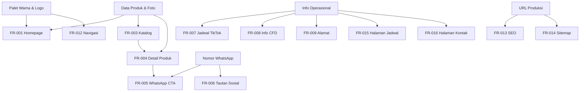

# Kebutuhan Produk — Delisert Website

| Metadata | |
|---|---|
| **Dokumen** | Kebutuhan Fungsional & Non-Fungsional |
| **Versi** | 1.0 |
| **Tanggal** | 30 Oktober 2026 |
| **Terintegrasi dengan** | `docs/PRD.md` |

---

## 1. Konvensi Dokumen

| Elemen | Keterangan |
|---|---|
| **ID** | `FR-xxx` untuk kebutuhan fungsional, `NFR-xxx` untuk non-fungsional |
| **Prioritas** | `MVP` (wajib pada rilis awal), `Future` (setelah MVP) |
| **User Story** | Format: *Sebagai [aktor], saya ingin [tindakan], sehingga [manfaat]* |
| **Acceptance Criteria** | Daftar kondisi yang harus terpenuhi agar kebutuhan dianggap selesai |
| **Dependencies** | Kebutuhan atau aset lain yang harus tersedia lebih dulu |

---

## 2. Kebutuhan Fungsional — Homepage

### FR-001 — Homepage dengan Section Lengkap

**Prioritas:** MVP

**User Story:**
> Sebagai pengunjung baru, saya ingin mendarat di homepage yang langsung memperkenalkan Delisert, produk unggulan, dan cara memesan, sehingga saya dapat memahami merek dan bertindak dalam satu kunjungan.

**Deskripsi:**
Homepage adalah halaman utama yang menampilkan seluruh informasi kunci dalam satu scroll berurutan: hero, brand introduction, produk unggulan, kategori, cerita merek, jadwal TikTok Live, info CFD Minggu, dan tautan sosial.

**Acceptance Criteria:**
- [ ] Section tampil dalam urutan: Navigasi → Hero → Brand Introduction → Produk Unggulan → Kategori → Cerita Merek → Jadwal TikTok Live → Info CFD → Sosial Media → Footer
- [ ] Hero menampilkan foto produk besar, headline merek, subheadline posisioning, CTA ke Menu, dan CTA ke WhatsApp
- [ ] Section Produk Unggulan menampilkan 3–4 produk dengan foto, nama, harga (jika tersedia), dan CTA
- [ ] Section Kategori menampilkan 5 kategori dengan tautan ke `/menu`
- [ ] Section Jadwal TikTok Live menampilkan "Selasa – Sabtu / 10:30–14:30 WITA" dan CTA "Follow Delisert on TikTok"
- [ ] Section Info CFD menjelaskan aktivitas Minggu tanpa menampilkan jam pasti
- [ ] Seluruh halaman responsif pada 375px, 768px, 1280px
- [ ] Waktu muat LCP < 2.5s pada koneksi 4G
- [ ] Tidak ada status "LIVE SEKARANG" yang ditampilkan

**Dependencies:** Foto produk asli, palet warna merek, data produk

---

### FR-002 — Halaman Tentang Delisert

**Prioritas:** MVP

**User Story:**
> Sebagai calon pelanggan, saya ingin membaca latar belakang Delisert dan memahami identitas merek, sehingga saya merasa percaya sebelum memesan.

**Deskripsi:**
Halaman `/tentang` menampilkan latar belakang bisnis (berdiri 2021), posisioning, identitas produk, dan fotografi merek.

**Acceptance Criteria:**
- [ ] Menampilkan informasi "Sejak 2021" dan posisioning "Dessert Makassar"
- [ ] Menampilkan identitas produk dengan penekanan pada Mochi sebagai produk anchor
- [ ] Menampilkan fotografi merek asli (bukan placeholder)
- [ ] **Tidak** memuat kisah pendiri, penghargaan, atau pencapaian yang dikarang
- [ ] Memiliki CTA ke Menu dan WhatsApp
- [ ] Metadata SEO unik untuk halaman ini
- [ ] Breadcrumb atau navigasi kembali ke Homepage

**Dependencies:** Foto merek asli, informasi filosofi merek (jika ada)

---

### FR-003 — Katalog Produk dengan Filter Kategori

**Prioritas:** MVP

**User Story:**
> Sebagai pengunjung, saya ingin melihat seluruh produk Delisert dan memfilternya berdasarkan kategori, sehingga saya dapat menemukan produk yang saya cari dengan cepat.

**Deskripsi:**
Halaman `/menu` menampilkan grid produk dengan filter kategori.

**Acceptance Criteria:**
- [ ] Menampilkan seluruh produk dalam grid responsif (1 kolom mobile, 2 kolom tablet, 3 kolom desktop)
- [ ] Filter kategori: Semua, Mochi, Pancake Durian, Mango Sticky Rice, Mille Crepes, Dubai Chewy Cookie, Slice Cake
- [ ] Filter berfungsi tanpa reload halaman penuh
- [ ] Setiap kartu produk menampilkan: foto, nama, kategori, harga (jika tersedia), status ketersediaan, CTA
- [ ] Produk dengan harga belum tersedia menampilkan "Hubungi untuk harga" — bukan "Rp 0" atau harga kosong
- [ ] Produk yang habis ditandai jelas dengan teks, bukan hanya warna
- [ ] Empty state ditampilkan ketika kategori tidak memiliki produk
- [ ] URL filter dapat dibagikan (misal `/menu?kategori=mochi`)
- [ ] Metadata SEO unik

**Dependencies:** Data produk di database, foto produk

---

### FR-004 — Detail Produk Individual

**Prioritas:** MVP

**User Story:**
> Sebagai pengunjung yang tertarik pada produk tertentu, saya ingin melihat foto, deskripsi, harga, dan varian secara lengkap, sehingga saya dapat memutuskan sebelum memesan.

**Deskripsi:**
Halaman `/menu/$slug` menampilkan detail lengkap satu produk.

**Acceptance Criteria:**
- [ ] URL menggunakan slug deskriptif (misal `/menu/mochi-matcha`)
- [ ] Menampilkan galeri foto produk (foto utama + foto tambahan)
- [ ] Menampilkan: nama produk, kategori, harga (jika ada), varian, deskripsi lengkap
- [ ] Menampilkan status ketersediaan: Tersedia / Pre-Order / Habis
- [ ] CTA WhatsApp dengan pesan terisi otomatis yang menyertakan nama produk dan varian terpilih
- [ ] Menampilkan 2–4 produk terkait dari kategori yang sama
- [ ] Breadcrumb: Menu / Kategori / Nama Produk
- [ ] Open Graph tags unik dengan foto produk
- [ ] Structured data `Product` (JSON-LD)
- [ ] Halaman 404 yang informatif jika slug tidak ditemukan
- [ ] Metadata SEO unik per produk

**Dependencies:** Data produk, foto produk, varian

---

### FR-005 — Pemesanan via WhatsApp dengan Pesan Terisi

**Prioritas:** MVP

**User Story:**
> Sebagai pelanggan yang sudah memutuskan produk, saya ingin menekan satu tombol dan langsung terbuka WhatsApp dengan pesan yang sudah berisi produk yang saya inginkan, sehingga saya tidak perlu mengetik dari awal.

**Deskripsi:**
Tombol CTA WhatsApp tersedia di seluruh halaman produk dan halaman kontak. Membuka `wa.me` dengan pesan terisi otomatis.

**Acceptance Criteria:**
- [ ] Tombol WhatsApp membuka `https://wa.me/6285190021421?text=<pesan-terenkode>`
- [ ] Pesan terisi menyertakan nama produk ketika diklik dari halaman/detail produk
- [ ] Pesan terisi menyertakan varian terpilih ketika ada
- [ ] Pesan generik digunakan ketika diklik dari navigasi atau homepage
- [ ] Nomor WhatsApp menggunakan format internasional (6285190021421)
- [ ] Tombol memiliki ukuran target sentuh minimal 44×44px
- [ ] Tombol memiliki label aksesibel yang jelas
- [ ] Tombol berfungsi pada mobile (membuka aplikasi WA) dan desktop (membuka WhatsApp Web)
- [ ] Klik WhatsApp dapat dilacak untuk analitik

**Dependencies:** Nomor WhatsApp bisnis

---

### FR-006 — Tautan Media Sosial

**Prioritas:** MVP

**User Story:**
> Sebagai pengunjung, saya ingin mengikuti Delisert di Instagram dan TikTok serta menghubungi via WhatsApp, sehingga saya dapat terus mendapatkan update produk dan promo.

**Deskripsi:**
Tautan ke Instagram, TikTok, dan WhatsApp tersedia di navigasi, footer, dan halaman kontak.

**Acceptance Criteria:**
- [ ] Tautan Instagram mengarah ke `https://www.instagram.com/delisert.mks/`
- [ ] Tautan TikTok mengarah ke `https://www.tiktok.com/@delisert.mkss`
- [ ] Tautan WhatsApp mengarah ke `wa.me/6285190021421`
- [ ] Tautan eksternal membuka di tab baru (`target="_blank"` dengan `rel="noopener"`)
- [ ] Ikon memiliki label aksesibel (nama platform)
- [ ] Tautan muncul di footer setiap halaman
- [ ] Klik tautan sosial dapat dilacak untuk analitik

**Dependencies:** Tidak ada

---

### FR-007 — Tampilan Jadwal TikTok Live

**Prioritas:** MVP

**User Story:**
> Sebagai pelanggan potensial, saya ingin tahu kapan Delisert melakukan TikTok Live, sehingga saya dapat menonton dan membeli saat live.

**Deskripsi:**
Menampilkan jadwal TikTok Live secara statis di homepage dan halaman Jadwal.

**Acceptance Criteria:**
- [ ] Menampilkan "TikTok Live / Selasa – Sabtu / 10:30–14:30 WITA"
- [ ] Menampilkan CTA "Follow Delisert on TikTok" yang mengarah ke profil TikTok
- [ ] **Tidak** menampilkan status "LIVE SEKARANG" atau indikator real-time
- [ ] **Tidak** mengklaim live sedang aktif tanpa integrasi real-time
- [ ] Zona waktu WITA disebutkan eksplisit
- [ ] Tampilan konsisten antara homepage dan halaman Jadwal

**Dependencies:** Tidak ada

---

### FR-008 — Tampilan Info CFD Minggu

**Prioritas:** MVP

**User Story:**
> Sebagai pengunjung yang ingin membeli langsung, saya ingin tahu di mana Delisert berjualan pada hari Minggu, sehingga saya dapat datang ke lokasi.

**Deskripsi:**
Menampilkan informasi aktivitas Car Free Day setiap hari Minggu beserta titik penjualan yang diketahui.

**Acceptance Criteria:**
- [ ] Menjelaskan bahwa Delisert berjualan langsung setiap hari Minggu saat aktivitas CFD
- [ ] Menampilkan titik penjualan yang diketahui:
  - CFD Boulevard — berhadapan Social Barn
  - CFD UNHAS — berhadapan Masjid UNHAS, area taman
- [ ] Menyatakan eksplisit bahwa titik penjualan bersifat **sementara** dan **bukan cabang tetap**
- [ ] Menyatakan bahwa lokasi terkini diumumkan melalui media sosial Delisert
- [ ] **Tidak** menampilkan jam operasional pasti untuk CFD
- [ ] **Tidak** menjamin kedua lokasi aktif setiap Minggu
- [ ] Menampilkan CTA ikuti media sosial untuk update lokasi

**Dependencies:** Konfirmasi jam dan frekuensi lokasi (untuk perbaikan Fase 2)

---

### FR-009 — Tampilan Alamat Operasional

**Prioritas:** MVP

**User Story:**
> Sebagai pelanggan atau kurir, saya ingin mengetahui alamat operasional Delisert, sehingga saya dapat mengirim atau mengambil pesanan.

**Deskripsi:**
Menampilkan alamat operasional di halaman Jadwal dan Kontak.

**Acceptance Criteria:**
- [ ] Menampilkan alamat lengkap:
  ```
  Delisert Mochi and Dessert
  Perumahan Villa Surya Mas, Cluster Harmonis 20,
  Jalan Toddopuli Raya Timur No. 20,
  RT.1/RW.24, Borong, Manggala,
  Makassar, Sulawesi Selatan, Indonesia.
  ```
- [ ] **Tidak** menampilkan jam buka toko permanen untuk alamat ini
- [ ] **Tidak** menyebut alamat ini sebagai "toko", "cabang", atau "storefront" sebelum konfirmasi
- [ ] Kode pos ditampilkan hanya setelah konfirmasi 90233 vs 90234
- [ ] Menyediakan tautan ke Google Maps untuk alamat tersebut
- [ ] Menyatakan bahwa status pengambulan pelanggan di alamat ini perlu dikonfirmasi

**Dependencies:** Konfirmasi kode pos, konfirmasi status pengambilan pelanggan

---

### FR-010 — Instruksi Pengambilan Pesanan

**Prioritas:** MVP

**User Story:**
> Sebagai pelanggan yang mengambil pesanan langsung, saya ingin tahu informasi apa yang harus saya sertakan, sehingga pengambilan pesanan berjalan lancar.

**Deskripsi:**
Menampilkan instruksi pengambilan pesanan yang disediakan bisnis.

**Acceptance Criteria:**
- [ ] Menampilkan instruksi: "Untuk memudahkan pengambilan pesanan, mohon sertakan nomor order atau 4 angka terakhir nomor WhatsApp yang digunakan saat memesan."
- [ ] Instruksi muncul di halaman Kontak dan/atau Jadwal
- [ ] **Tidak** meminta pelanggan menampilkan nomor WhatsApp lengkap secara publik
- [ ] Bahasa instruksi menggunakan Bahasa Indonesia yang sopan

**Dependencies:** Tidak ada

---

### FR-011 — Informasi Metode Pengiriman

**Prioritas:** MVP

**User Story:**
> Sebagai pelanggan yang ingin pesan antar, saya ingin tahu metode pengiriman apa yang tersedia, sehingga saya dapat memilih yang paling sesuai.

**Deskripsi:**
Menampilkan metode pengiriman yang disebutkan bisnis, dengan status "tunduk pada konfirmasi".

**Acceptance Criteria:**
- [ ] Menampilkan metode: Gojek/GoSend, GrabExpress, Maxim, Shopee
- [ ] Menyatakan bahwa ketersediaan, tarif, dan cakupan pengiriman **dikonfirmasi saat pemesanan**
- [ ] **Tidak** menampilkan tarif pengiriman
- [ ] **Tidak** menampilkan estimasi waktu pengiriman
- [ ] **Tidak** menjamin cakupan area tertentu
- [ ] Menampilkan CTA hubungi WhatsApp untuk konfirmasi pengiriman

**Dependencies:** Konfirmasi layanan Shopee yang tepat, konfirmasi cakupan

---

### FR-012 — Navigasi Responsif

**Prioritas:** MVP

**User Story:**
> Sebagai pengunjung mobile, saya ingin menavigasi website dengan mudah pada layar kecil, sehingga saya dapat berpindah halaman tanpa kesulitan.

**Deskripsi:**
Navigasi utama responsif dengan menu hamburger pada mobile.

**Acceptance Criteria:**
- [ ] Navigasi desktop menampilkan: Logo, Tentang, Menu, Jadwal, Kontak, tombol WhatsApp
- [ ] Navigasi mobile menampilkan logo dan tombol hamburger
- [ ] Menu mobile terbuka dan menutup dengan animasi halus
- [ ] Menu mobile dapat ditutup dengan tombol, klik luar, atau tombol Escape
- [ ] Item navigasi aktif ditandai secara visual
- [ ] Navigasi tetap terlihat (sticky) saat scroll
- [ ] Target sentuh minimal 44×44px untuk semua item navigasi
- [ ] Navigasi dapat dioperasikan sepenuhnya dengan keyboard

**Dependencies:** Logo merek

---

### FR-013 — Metadata SEO Dasar

**Prioritas:** MVP

**User Story:**
> Sebagai pemilik bisnis, saya ingin website muncul di hasil pencarian lokal, sehingga pelanggan baru dapat menemukan Delisert secara organik.

**Deskripsi:**
Metadata SEO unik untuk setiap halaman.

**Acceptance Criteria:**
- [ ] Setiap halaman memiliki `<title>` unik yang deskriptif
- [ ] Setiap halaman memiliki `<meta name="description">` unik
- [ ] Title homepage: "Delisert — Mochi & Dessert Makassar | Sejak 2021"
- [ ] Title menyertakan kata kunci lokal (Makassar) bila relevan
- [ ] Panjang title < 60 karakter, description < 160 karakter
- [ ] Atribut `lang="id"` pada elemen `<html>`
- [ ] Canonical URL ditetapkan per halaman

**Dependencies:** URL produksi final

---

### FR-014 — Sitemap dan Robots.txt

**Prioritas:** MVP

**User Story:**
> Sebagai pemilik bisnis, saya ingin mesin pencari dapat mengindeks seluruh halaman website dengan benar, sehingga visibilitas pencarian maksimal.

**Deskripsi:**
Sitemap XML dan robots.txt yang benar.

**Acceptance Criteria:**
- [ ] `robots.txt` mengizinkan crawling seluruh halaman publik
- [ ] `robots.txt` menyertakan referensi ke sitemap
- [ ] `sitemap.xml` mencakup: `/`, `/tentang`, `/menu`, `/menu/$slug` (semua produk), `/jadwal`, `/kontak`
- [ ] Sitemap diperbarui otomatis saat produk ditambahkan
- [ ] Sitemap dan robots.txt dapat diakses di root domain

**Dependencies:** URL produksi final

---

### FR-015 — Halaman Jadwal & Lokasi

**Prioritas:** MVP

**User Story:**
> Sebagai pengunjung, saya ingin melihat seluruh informasi jadwal dan lokasi di satu halaman, sehingga saya tahu kapan dan di mana Delisert beroperasi.

**Deskripsi:**
Halaman `/jadwal` yang memisahkan dengan jelas: TikTok Live, CFD Minggu, hari Senin, dan alamat operasional.

**Acceptance Criteria:**
- [ ] Section TikTok Live terpisah secara visual dari section CFD
- [ ] Section CFD menyatakan eksplisit bahwa titik penjualan bersifat sementara
- [ ] Section Senin menampilkan "Senin — Tutup / Libur"
- [ ] Section Alamat Operasional terpisah dan tidak menyiratkan toko ritel
- [ ] Tidak ada jam operasional toko permanen yang ditampilkan
- [ ] Tautan ke Google Maps untuk alamat operasional
- [ ] Metadata SEO unik

**Dependencies:** Konfirmasi informasi operasional

---

### FR-016 — Halaman Kontak & Pesan

**Prioritas:** MVP

**User Story:**
> Sebagai pelanggan, saya ingin menghubungi Delisert dan memahami cara memesan serta pengiriman, sehingga saya dapat melakukan transaksi dengan percaya diri.

**Deskripsi:**
Halaman `/kontak` yang menampilkan kontak, instruksi pemesanan, instruksi pengambilan, dan informasi pengiriman.

**Acceptance Criteria:**
- [ ] Menampilkan nomor WhatsApp 085190021421 dengan tombol chat langsung
- [ ] Menampilkan tautan Instagram dan TikTok
- [ ] Menampilkan instruksi pengambilan pesanan (FR-010)
- [ ] Menampilkan metode pengiriman (FR-011)
- [ ] Menampilkan alamat operasional dengan tautan ke halaman Jadwal
- [ ] Menampilkan ringkasan alur pemesanan: pilih produk → klik WhatsApp → konfirmasi
- [ ] **Tidak** ada formulir kontak yang memerlukan backend email
- [ ] Metadata SEO unik

**Dependencies:** Tidak ada

---

## 3. Kebutuhan Fungsional — Future

### FR-101 — Dashboard Admin

**Prioritas:** Future

**User Story:**
> Sebagai pemilik bisnis, saya ingin mengelola konten website melalui dashboard, sehingga saya tidak perlu meminta bantuan teknis untuk memperbarui produk.

**Acceptance Criteria:**
- [ ] Autentikasi sederhana (satu pengguna)
- [ ] Dashboard menampilkan ringkasan produk
- [ ] Akses terbatas pada rute `/admin`

**Dependencies:** Keputusan autentikasi, FR-102

---

### FR-102 — Manajemen Produk

**Prioritas:** Future

**User Story:**
> Sebagai pemilik bisnis, saya ingin menambah, mengubah, dan menghapus produk melalui UI, sehingga katalog selalu terkini.

**Acceptance Criteria:**
- [ ] Tambah produk baru dengan foto, nama, deskripsi, harga, kategori, varian
- [ ] Ubah produk yang ada
- [ ] Hapus atau nonaktifkan produk
- [ ] Unggah foto produk
- [ ] Pratinjau perubahan sebelum publikasi

**Dependencies:** FR-101, penyimpanan gambar

---

### FR-103 — Manajemen Promosi

**Prioritas:** Future

**User Story:**
> Sebagai pemilik bisnis, saya ingin menampilkan promo atau batch PO di website, sehingga pelanggan mengetahui penawaran terkini.

**Acceptance Criteria:**
- [ ] Buat dan publikasikan promosi dengan tanggal mulai/berakhir
- [ ] Promosi tampil di homepage
- [ ] Promosi kedaluwarsa disembunyikan otomatis

**Dependencies:** FR-101

---

### FR-104 — Inventaris Produk

**Prioritas:** Future

**User Story:**
> Sebagai pemilik bisnis, saya ingin menandai produk habis atau terbatas, sehingga pelanggan tidak memesan produk yang tidak tersedia.

**Acceptance Criteria:**
- [ ] Status stok per produk/varian
- [ ] Produk habis ditandai otomatis di katalog
- [ ] Notifikasi saat stok menipis

**Dependencies:** FR-102

---

### FR-105 — Manajemen Pesanan Otomatis

**Prioritas:** Future

**User Story:**
> Sebagai pemilik bisnis, saya ingin pesanan dari website tercatat otomatis, sehingga saya tidak kehilangan informasi pesanan.

**Acceptance Criteria:**
- [ ] Pesanan WhatsApp tercatat di database
- [ ] Status pesanan dapat diperbarui
- [ ] Riwayat pesanan dapat dilihat

**Dependencies:** FR-101, keputusan integrasi WhatsApp Business API

---

### FR-106 — Pembayaran Daring

**Prioritas:** Future

**User Story:**
> Sebagai pelanggan, saya ingin membayar secara daring, sehingga saya tidak perlu transfer manual.

**Acceptance Criteria:**
- [ ] Integrasi payment gateway (Midtrans/Xendit/QRIS)
- [ ] Checkout aman
- [ ] Konfirmasi pembayaran otomatis

**Dependencies:** Evaluasi ulang kebutuhan bisnis, keputusan payment gateway

---

### FR-107 — Testimoni Pelanggan Terkurasi

**Prioritas:** Future

**User Story:**
> Sebagai pengunjung baru, saya ingin membaca ulasan pelanggan lain, sehingga saya lebih percaya pada kualitas produk.

**Acceptance Criteria:**
- [ ] Testimoni ditampilkan di homepage
- [ ] Izin tertulis dari pelanggan tersimpan
- [ ] Testimoni dapat dikelola melalui admin

**Dependencies:** FR-101, izin pelanggan

---

### FR-108 — Integrasi Status TikTok Live Real-Time

**Prioritas:** Future

**User Story:**
> Sebagai pengunjung, saya ingin tahu apakah Delisert sedang live di TikTok, sehingga saya dapat bergabung saat itu juga.

**Acceptance Criteria:**
- [ ] Status live ditampilkan secara akurat
- [ ] Indikator "LIVE SEKARANG" hanya tampil saat benar-benar live
- [ ] Data diperbarui secara berkala

**Dependencies:** API TikTok atau sumber data live status

---

### FR-109 — Notifikasi Restock

**Prioritas:** Future

**User Story:**
> Sebagai pelanggan yang ketinggalan batch, saya ingin diberi tahu saat produk tersedia kembali, sehingga saya tidak kehilangan kesempatan.

**Acceptance Criteria:**
- [ ] Formulir pendaftaran notifikasi
- [ ] Notifikasi dikirim saat produk restock
- [ ] Preferensi notifikasi dapat dikelola

**Dependencies:** FR-104, layanan notifikasi

---

## 4. Kebutuhan Non-Fungsional

### NFR-001 — Performa Waktu Muat

**Persyaratan:**
- Largest Contentful Paint (LCP) < 2.5 detik pada koneksi 4G dengan perangkat seluler kelas menengah
- First Input Delay (FID) / Interaction to Next Paint (INP) < 200 ms
- Cumulative Layout Shift (CLS) < 0.1
- Time to First Byte (TTFB) < 800 ms

**Verifikasi:** Lighthouse CI atau pengujian manual pada perangkat nyata.

---

### NFR-002 — Ukuran Halaman

**Persyaratan:**
- Total transfer per halaman < 500 KB (tidak termasuk foto, yang harus dioptimalkan terpisah)
- JavaScript client-side diminimalkan; utamakan SSR
- Setiap foto produk < 200 KB setelah kompresi

**Verifikasi:** Inspeksi Network tab DevTools.

---

### NFR-003 — Format dan Optimasi Gambar

**Persyaratan:**
- Semua foto menggunakan format modern (WebP atau AVIF) dengan fallback JPEG/PNG
- Responsive images dengan `srcset` untuk berbagai ukuran layar dan DPR
- `loading="lazy"` untuk foto di bawah fold
- `fetchpriority="high"` untuk foto hero
- Dimensi eksplisit (`width`/`height`) pada setiap elemen `` untuk mencegah CLS
- Alt text deskriptif pada setiap foto

**Verifikasi:** Inspeksi markup dan Lighthouse.

---

### NFR-004 — SEO Teknis

**Persyaratan:**
- Metadata `<title>` dan `<meta name="description">` unik per halaman
- Open Graph tags lengkap (`og:title`, `og:description`, `og:image`, `og:type`, `og:locale`)
- Twitter Card tags (`twitter:card`, `twitter:title`, `twitter:description`, `twitter:image`)
- Canonical URL per halaman
- `sitemap.xml` mencakup seluruh halaman publik
- `robots.txt` mengizinkan crawling
- URL bersih dan deskriptif (slug, bukan ID)
- Structured data JSON-LD: `LocalBusiness` dan `Product`
- Hierarki heading benar (satu `<h1>`, tidak melewatkan level)

**Verifikasi:** Google Rich Results Test, Lighthouse SEO audit.

---

### NFR-005 — Aksesibilitas

**Persyaratan:**
- Kontras warna minimum WCAG AA: 4.5:1 untuk teks normal, 3:1 untuk teks besar
- Seluruh situs dapat dioperasikan dengan keyboard
- Indikator fokus yang terlihat jelas pada semua elemen interaktif
- Semua foto memiliki alt text yang bermakna
- Semua input formulir memiliki label yang terasosiasi
- Status ketersediaan produk tidak hanya disampaikan melalui warna
- Atribut `lang="id"` pada `<html>`
- Skip-to-content link pada awal dokumen
- Urutan DOM logis untuk pembaca layar

**Verifikasi:** Audit axe DevTools, pengujian keyboard manual, pengujian pembaca layar.

---

### NFR-006 — Kompatibilitas Browser

**Persyaratan:**
- Chrome, Safari, Firefox, Edge — 2 versi terakhir
- iOS Safari dan Android Chrome sebagai prioritas utama
- Tidak ada dukungan untuk Internet Explorer

**Verifikasi:** Pengujian pada BrowserStack atau perangkat nyata.

---

### NFR-007 — Bahasa

**Persyaratan:**
- Bahasa Indonesia adalah bahasa utama seluruh antarmuka
- Tidak ada campuran bahasa Inggris yang tidak perlu
- Format angka dan mata uang mengikuti konvensi Indonesia (Rp 25.000)
- Format tanggal mengikuti konvensi Indonesia

---

### NFR-008 — Keamanan

**Persyaratan:**
- HTTPS wajib (disediakan Cloudflare)
- Tidak ada rahasia yang terekspos di kode client-side
- Tidak ada data pribadi pelanggan yang disimpan pada MVP
- Input pengguna divalidasi pada batas sistem (meskipun MVP minim input)
- Header keamanan dasar (X-Content-Type-Options, X-Frame-Options)

---

### NFR-009 — Maintainability

**Persyaratan:**
- Kode mengikuti konvensi scaffold yang ada
- Komponen UI bersama ditempatkan di `packages/ui`
- Logika bisnis ditempatkan di `packages/api`
- Skema database ditempatkan di `packages/db`
- Tidak ada duplikasi logika antar paket
- TypeScript strict mode diaktifkan
- Tidak ada `any` yang tidak perlu

---

### NFR-010 — Deployment

**Persyaratan:**
- Deployment melalui Alchemy ke Cloudflare
- Migrasi database diterapkan otomatis saat deploy
- Environment development berjalan di `localhost:3001`
- Rollback dimungkahkan melalui deploy versi sebelumnya
- Build berhasil melalui `bun run build` (Turborepo)

---

## 5. Matriks Prioritas

| Kategori | MVP | Future |
|---|---|---|
| **Halaman** | Homepage, Tentang, Menu, Detail Produk, Jadwal, Kontak | Dashboard Admin |
| **Fitur** | Katalog, filter, WhatsApp CTA, jadwal, lokasi, kontak | Manajemen produk, promo, inventaris, pesanan, pembayaran |
| **Teknis** | SEO, OG, sitemap, robots, structured data, optimasi gambar | Analitik lanjutan, notifikasi, integrasi TikTok Live |
| **Konten** | Semua konten statis dari pemilik bisnis | Testimoni terkurasi, blog |

---

## 6. Ketergantungan Antar Kebutuhan



---

*Dokumen ini terintegrasi dengan `docs/PRD.md`. Setiap perubahan kebutuhan harus memperbarui kedua dokumen.*
