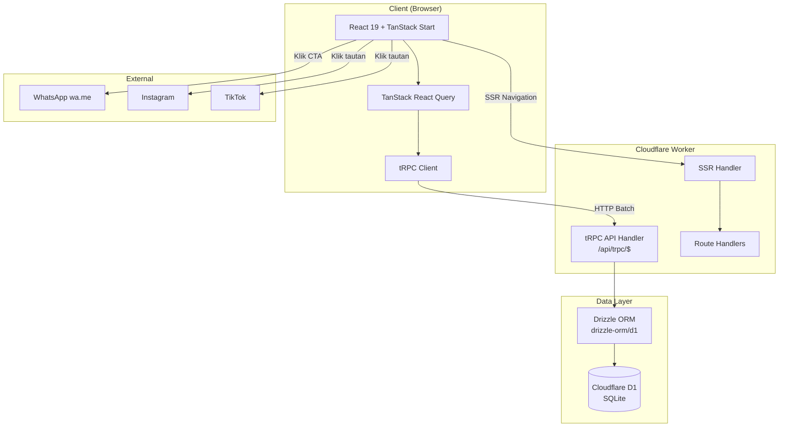
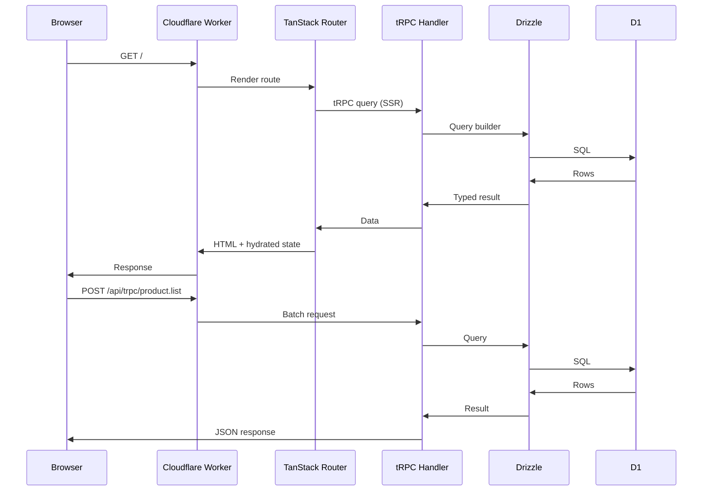
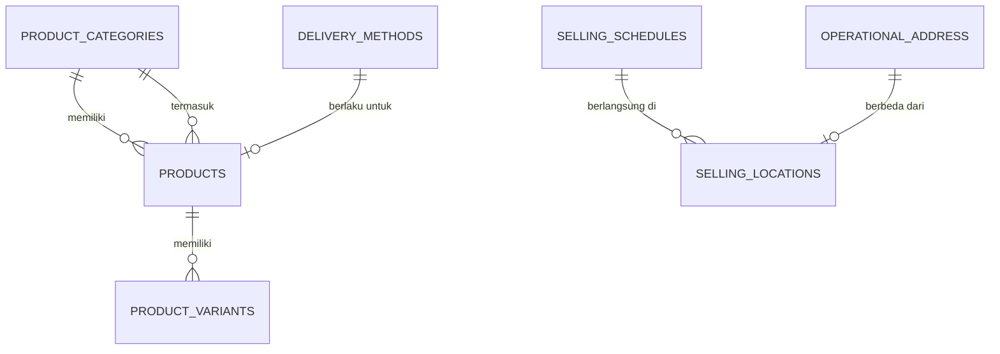
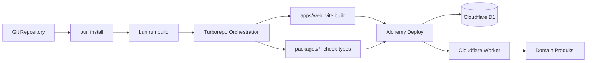

# Arsitektur Teknis — Delisert Website

| Metadata | |
|---|---|
| **Dokumen** | Technical Architecture |
| **Versi** | 1.1 |
| **Tanggal** | 30 Oktober 2026 |
| **Basis** | Inspeksi langsung scaffold Better-T-Stack yang ada |
| **Terintegrasi dengan** | `docs/PRD.md` |

---

## 1. Stack Teknologi (TETAP — Tidak Berubah)

Stack sudah ditetapkan dan di-*scaffold*. Dokumen ini **tidak** mengusulkan penggantian framework.

### 1.1 Komponen Terverifikasi dari Scaffold

| Komponen | Teknologi | Versi | Lokasi Terverifikasi |
|---|---|---|---|
| Scaffold generator | Better-T-Stack | 3.49.0 | `bts.jsonc` |
| Frontend framework | TanStack Start | ^1.169.1 | `apps/web/package.json` |
| Router | TanStack Router | ^1.170.44 | `apps/web/package.json` |
| Query | TanStack React Query | ^5.104.2 | `apps/web/package.json` |
| UI library | React | ^19.3.0 | `apps/web/package.json` |
| Styling | TailwindCSS | ^4.3.3 | `apps/web/package.json` |
| UI primitives | shadcn/ui (shared package) | — | `packages/ui/` |
| API | tRPC | ^11.19.0 | `packages/api/` |
| tRPC React Query | @trpc/tanstack-react-query | ^11.19.0 | `apps/web/package.json` |
| ORM | Drizzle ORM | — | `packages/db/` |
| Database | Cloudflare D1 (SQLite) | — | `packages/db/drizzle.config.ts` |
| Package manager | Bun | 1.4.4 | `package.json` |
| Monorepo | Turborepo | ^2.11.7 | `turbo.json` |
| Deployment | Cloudflare via Alchemy | — | `packages/infra/alchemy.run.ts` |
| Env management | Varlock | 1.23.0 | `apps/web/.env.schema` |
| Icons | lucide-react | ^1.56.0 | `apps/web/package.json` |
| Toasts | sonner | ^2.0.8 | `packages/ui/` |
| TypeScript | TypeScript | ^6.0.3 | catalog |
| **Desain UI (wajib)** | **Google Stitch via MCP `@google/stitch`** | **0.12.1** | **`.mcp.json` (entri `stitch`)** |

### 1.2 Yang TIDAK Ada (Sesuai Keputusan)

| Komponen | Status |
|---|---|
| Autentikasi | ❌ Tidak ada (`--auth none`) |
| Pembayaran | ❌ Tidak ada (`--payments none`) |
| Backend runtime terpisah | ❌ Tidak ada (`--runtime none`, `--server-deploy none`) |
| Contoh tambahan | ❌ Tidak ada (`--examples none`) |
| Better Auth | ❌ Tidak ada |

### 1.3 Perintah Reproduksi Scaffold

```bash
bun create better-t-stack@latest delisert.mks-1 \
  --frontend tanstack-start \
  --backend self \
  --runtime none \
  --database sqlite \
  --orm drizzle \
  --api trpc \
  --auth none \
  --payments none \
  --addons mcp turborepo \
  --examples none \
  --db-setup d1 \
  --web-deploy cloudflare \
  --server-deploy none \
  --git \
  --package-manager bun \
  --install
```

---

## 2. Arsitektur Sistem

### 2.1 Diagram Arsitektur



### 2.2 Alur Request



---

## 3. Struktur Folder (Berdasarkan Scaffold Aktual)

### 3.1 Struktur Saat Ini vs. Target

```
delisert.mks-1/
├── apps/
│   └── web/
│       ├── public/
│       │   └── robots.txt              ✅ Ada — perlu diperluas
│       └── src/
│           ├── components/
│           │   ├── header.tsx          ⚠️ Ada — perlu ditulis ulang
│           │   └── loader.tsx          ✅ Ada — dapat digunakan
│           ├── routes/
│           │   ├── __root.tsx          ⚠️ Ada — perlu diubah (lang, tema, meta)
│           │   ├── index.tsx           ⚠️ Ada — perlu ditulis ulang total
│           │   └── api/trpc/$.ts       ✅ Ada — jangan diubah
│           ├── utils/trpc.ts           ✅ Ada
│           ├── services.ts             ✅ Ada — getDb()
│           ├── router.tsx              ✅ Ada
│           ├── context.ts              ✅ Ada — tRPC context
│           ├── env.ts                  ✅ Autogenerated (Varlock)
│           ├── env.server.ts           ✅ Ada
│           └── index.css               ✅ Ada
├── packages/
│   ├── api/src/
│   │   ├── index.ts                    ✅ Ada — initTRPC
│   │   ├── context.ts                  ✅ Ada — { db }
│   │   └── routers/
│   │       └── index.ts                ⚠️ Ada — hanya healthCheck, perlu diperluas
│   ├── db/src/
│   │   ├── config.ts                   ✅ Ada — DatabaseConfig
│   │   ├── index.ts                    ✅ Ada — createDb()
│   │   ├── relations.ts                ✅ Ada — defineRelations
│   │   ├── schema/
│   │   │   └── index.ts                ❌ KOSONG (export {}) — perlu diisi
│   │   └── migrations/                 ❌ KOSONG — perlu generate
│   ├── ui/src/
│   │   ├── components/                 ✅ 16 komponen tersedia
│   │   ├── styles/globals.css          ⚠️ Token netral — perlu palet merek
│   │   └── lib/utils.ts                ✅ Ada
│   ├── config/                         ✅ tsconfig dasar
│   └── infra/
│       └── alchemy.run.ts              ✅ Ada — D1 + Website.Vite
├── docs/                               📝 Dokumentasi PRD
├── bts.jsonc                           ✅ Metadata stack
├── turbo.json                          ✅ Task definitions
└── package.json                        ✅ Workspace + catalog
```

### 3.2 File Baru yang Perlu Dibuat

```
apps/web/src/
├── routes/
│   ├── tentang.tsx                     🆕 Halaman Tentang
│   ├── menu.tsx                        🆕 Katalog produk
│   ├── menu.$slug.tsx                  🆕 Detail produk
│   ├── jadwal.tsx                      🆕 Jadwal & Lokasi
│   ├── kontak.tsx                      🆕 Kontak & Pesan
│   └── sitemap[.]xml.ts                🆕 Sitemap dinamis (opsional)
├── components/
│   ├── navbar.tsx                      🆕 Navigasi responsif
│   ├── mobile-nav.tsx                  🆕 Menu hamburger
│   ├── footer.tsx                      🆕 Footer
│   ├── product-card.tsx                🆕 Kartu produk
│   ├── product-gallery.tsx             🆕 Galeri foto
│   ├── whatsapp-button.tsx             🆕 CTA WhatsApp
│   ├── schedule-card.tsx               🆕 Kartu jadwal
│   ├── social-links.tsx                🆕 Tautan sosial
│   ├── section-heading.tsx             🆕 Heading section
│   ├── availability-badge.tsx          🆕 Badge ketersediaan
│   └── seo.tsx                         🆕 Helper metadata SEO
├── lib/
│   ├── whatsapp.ts                     🆕 Utilitas pesan WA
│   └── site-config.ts                  🆕 Konstanta situs
└── data/
    ├── categories.ts                   🆕 Konstanta kategori
    ├── schedules.ts                    🆕 Konstanta jadwal
    ├── locations.ts                    🆕 Konstanta lokasi CFD
    ├── delivery.ts                     🆕 Konstanta metode pengiriman
    └── social.ts                       🆕 Konstanta tautan sosial

packages/api/src/
├── routers/
│   ├── index.ts                        🔧 Perluas appRouter
│   ├── product.ts                      🆕 Router produk
│   └── schedule.ts                     🆕 Router jadwal
└── data/
    └── seed.ts                         🆕 Data awal produk

packages/db/src/
└── schema/
    └── index.ts                        🔧 Isi skema Drizzle

packages/ui/src/
└── components/
    ├── product-card.tsx                🆕 (atau di app, lihat catatan)
    ├── whatsapp-button.tsx             🆕
    └── badge.tsx                       🆕 shadcn primitive
```

**Catatan penempatan komponen:** Komponen generik yang dapat digunakan ulang ditempatkan di `packages/ui`. Komponen spesifik domain Delisert (ProductCard dengan logika harga Delisert) ditempatkan di `apps/web/src/components`. Ikuti konvensi README scaffold.

---

## 4. Model Data

### 4.1 Diagram Relasi



### 4.2 Skema Drizzle (Target)

> **Catatan:** Skema di bawah adalah definisi target. File `packages/db/src/schema/index.ts` saat ini kosong (`export {}`).

```typescript
// packages/db/src/schema/index.ts (target)
import { sql } from "drizzle-orm";
import { integer, sqliteTable, text } from "drizzle-orm/sqlite-core";

export const productCategories = sqliteTable("product_categories", {
  id: integer("id").primaryKey({ autoIncrement: true }),
  slug: text("slug").notNull().unique(),
  name: text("name").notNull(),
  description: text("description"),
  displayOrder: integer("display_order").notNull().default(0),
  isActive: integer("is_active", { mode: "boolean" }).notNull().default(true),
  createdAt: text("created_at").notNull().default(sql`(CURRENT_TIMESTAMP)`),
});

export const products = sqliteTable("products", {
  id: integer("id").primaryKey({ autoIncrement: true }),
  categoryId: integer("category_id").notNull().references(() => productCategories.id),
  slug: text("slug").notNull().unique(),
  name: text("name").notNull(),
  description: text("description"),
  priceCents: integer("price_cents"),
  currency: text("currency").notNull().default("IDR"),
  imageUrl: text("image_url"),
  imageAlt: text("image_alt"),
  isFeatured: integer("is_featured", { mode: "boolean" }).notNull().default(false),
  availability: text("availability").notNull().default("available"),
  displayOrder: integer("display_order").notNull().default(0),
  createdAt: text("created_at").notNull().default(sql`(CURRENT_TIMESTAMP)`),
  updatedAt: text("updated_at").notNull().default(sql`(CURRENT_TIMESTAMP)`),
});

export const productVariants = sqliteTable("product_variants", {
  id: integer("id").primaryKey({ autoIncrement: true }),
  productId: integer("product_id").notNull().references(() => products.id, { onDelete: "cascade" }),
  name: text("name").notNull(),
  priceCents: integer("price_cents"),
  isAvailable: integer("is_available", { mode: "boolean" }).notNull().default(true),
  displayOrder: integer("display_order").notNull().default(0),
});
```

### 4.3 Detail Field per Entitas

#### `product_categories`

| Field | Tipe | Wajib | Deskripsi | Contoh |
|---|---|---|---|---|
| `id` | integer (PK, auto) | Ya | Identitas unik | `1` |
| `slug` | text (unique) | Ya | Slug URL-friendly | `mochi` |
| `name` | text | Ya | Nama tampilan | `Mochi` |
| `description` | text | Tidak | Deskripsi kategori | `Mochi lembut dengan berbagai varian rasa` |
| `display_order` | integer | Ya | Urutan tampil | `1` |
| `is_active` | boolean | Ya | Status aktif | `true` |
| `created_at` | text (timestamp) | Ya | Waktu dibuat | `2026-10-30 10:00:00` |

#### `products`

| Field | Tipe | Wajib | Deskripsi | Contoh |
|---|---|---|---|---|
| `id` | integer (PK, auto) | Ya | Identitas unik | `1` |
| `category_id` | integer (FK) | Ya | Referensi kategori | `1` |
| `slug` | text (unique) | Ya | Slug URL | `mochi-matcha` |
| `name` | text | Ya | Nama produk | `Mochi Matcha` |
| `description` | text | Tidak | Deskripsi lengkap | `Mochi lembut dengan isian krim matcha...` |
| `price_cents` | integer | Tidak | Harga dalam sen (null = belum ada) | `3500000` (Rp 35.000) |
| `currency` | text | Ya | Mata uang | `IDR` |
| `image_url` | text | Tidak | URL foto utama | `/products/mochi-matcha.jpg` |
| `image_alt` | text | Tidak | Alt text foto | `Mochi matcha Delisert Makassar` |
| `is_featured` | boolean | Ya | Produk unggulan | `true` |
| `availability` | text (enum) | Ya | `available` / `preorder` / `soldout` | `available` |
| `display_order` | integer | Ya | Urutan tampil | `1` |
| `created_at` | text | Ya | Waktu dibuat | — |
| `updated_at` | text | Ya | Waktu diperbarui | — |

**Catatan harga:** Gunakan `price_cents` (integer) bukan float untuk menghindari kesalahan pembulatan. `null` berarti harga belum tersedia — tampilkan "Hubungi untuk harga".

#### `product_variants`

| Field | Tipe | Wajib | Deskripsi | Contoh |
|---|---|---|---|---|
| `id` | integer (PK, auto) | Ya | Identitas unik | `1` |
| `product_id` | integer (FK) | Ya | Referensi produk | `1` |
| `name` | text | Ya | Nama varian | `Isi 8 pcs` |
| `price_cents` | integer | Tidak | Harga varian (null = sama dengan produk) | `3500000` |
| `is_available` | boolean | Ya | Ketersediaan varian | `true` |
| `display_order` | integer | Ya | Urutan tampil | `1` |

### 4.4 Entitas Konstanta (Tidak di Database)

Entitas berikut bersifat sangat statis dan disimpan sebagai konstanta TypeScript:

#### `selling_schedules` (konstanta)

| Field | Tipe | Deskripsi | Contoh |
|---|---|---|---|
| `id` | string | Identitas | `tiktok-live` |
| `type` | enum | `tiktok_live` / `cfd` / `closed` | `tiktok_live` |
| `label` | string | Label tampil | `TikTok Live` |
| `days` | string | Hari operasi | `Selasa – Sabtu` |
| `hours` | string | Jam operasi | `10:30–14:30 WITA` |
| `description` | string | Penjelasan tambahan | — |
| `ctaLabel` | string | Label tombol | `Follow Delisert on TikTok` |
| `ctaUrl` | string | URL tombol | `https://www.tiktok.com/@delisert.mkss` |

#### `selling_locations` (konstanta)

| Field | Tipe | Deskripsi | Contoh |
|---|---|---|---|
| `id` | string | Identitas | `cfd-boulevard` |
| `name` | string | Nama lokasi | `CFD Boulevard` |
| `landmark` | string | Patokan | `Berhadapan Social Barn` |
| `isTemporary` | boolean | Lokasi sementara | `true` |
| `scheduleNote` | string | Catatan jadwal | `Lokasi diumumkan via media sosial` |

#### `operational_address` (konstanta)

| Field | Tipe | Deskripsi | Contoh |
|---|---|---|---|
| `name` | string | Nama tempat | `Delisert Mochi and Dessert` |
| `street` | string | Jalan | `Jalan Toddopuli Raya Timur No. 20` |
| `complex` | string | Perumahan/cluster | `Perumahan Villa Surya Mas, Cluster Harmonis 20` |
| `rtRw` | string | RT/RW | `RT.1/RW.24` |
| `village` | string | Kelurahan | `Borong` |
| `district` | string | Kecamatan | `Manggala` |
| `city` | string | Kota | `Makassar` |
| `province` | string | Provinsi | `Sulawesi Selatan` |
| `postalCode` | string \| null | Kode pos (null = belum dikonfirmasi) | `null` |
| `mapsUrl` | string | Tautan Google Maps | — |
| `isPublicRetail` | boolean | Bukan toko ritel publik | `false` |

#### `delivery_methods` (konstanta)

| Field | Tipe | Deskripsi | Contoh |
|---|---|---|---|
| `id` | string | Identitas | `gosend` |
| `name` | string | Nama layanan | `Gojek / GoSend` |
| `note` | string | Catatan | `Ketersediaan dikonfirmasi saat pemesanan` |

#### `social_media` (konstanta)

| Field | Tipe | Deskripsi | Contoh |
|---|---|---|---|
| `id` | string | Identitas | `instagram` |
| `platform` | string | Platform | `Instagram` |
| `url` | string | URL | `https://www.instagram.com/delisert.mks/` |
| `handle` | string | Username | `@delisert.mks` |

### 4.5 Entitas Future

| Entitas | Tujuan | Fase |
|---|---|---|
| `promotions` | Promosi dan batch PO | Fase 2 |
| `testimonials` | Testimoni pelanggan | Fase 2 |
| `orders` | Pencatatan pesanan | Fase 3 |
| `users` | Akun admin | Fase 2 |

---

## 5. Kebutuhan API (tRPC)

### 5.1 Router Saat Ini

```typescript
// packages/api/src/routers/index.ts (saat ini)
export const appRouter = router({
  healthCheck: publicProcedure.query(() => "OK"),
});
```

### 5.2 Router Target

```typescript
// packages/api/src/routers/index.ts (target)
import { publicProcedure, router } from "../index";
import { productRouter } from "./product";
import { scheduleRouter } from "./schedule";

export const appRouter = router({
  healthCheck: publicProcedure.query(() => "OK"),
  product: productRouter,
  schedule: scheduleRouter,
});

export type AppRouter = typeof appRouter;
```

### 5.3 Endpoint: Product

#### `product.list`

**Input:**
```typescript
z.object({
  category: z.string().optional(),  // slug kategori
  featuredOnly: z.boolean().optional(),
}).optional()
```

**Output:**
```typescript
Array<{
  id: number;
  slug: string;
  name: string;
  description: string | null;
  priceCents: number | null;
  imageUrl: string | null;
  imageAlt: string | null;
  availability: "available" | "preorder" | "soldout";
  category: { slug: string; name: string };
  variants: Array<{ id: number; name: string; priceCents: number | null }>;
}>
```

#### `product.bySlug`

**Input:**
```typescript
z.object({ slug: z.string() })
```

**Output:**
```typescript
{
  id: number;
  slug: string;
  name: string;
  description: string | null;
  priceCents: number | null;
  imageUrl: string | null;
  imageAlt: string | null;
  availability: "available" | "preorder" | "soldout";
  category: { slug: string; name: string };
  variants: Array<{ id: number; name: string; priceCents: number | null; isAvailable: boolean }>;
  related: Array<{ slug: string; name: string; imageUrl: string | null }>;
}
```

#### `product.categories`

**Output:**
```typescript
Array<{ slug: string; name: string; productCount: number }>
```

### 5.4 Endpoint: Schedule

#### `schedule.all`

**Output:**
```typescript
{
  tiktokLive: {
    label: string;
    days: string;
    hours: string;
    timezone: string;
    ctaLabel: string;
    ctaUrl: string;
  };
  cfd: {
    description: string;
    locations: Array<{ name: string; landmark: string }>;
    scheduleNote: string;
  };
  closedDay: { label: string; day: string };
  operationalAddress: { /* lihat §4.4 */ };
  deliveryMethods: Array<{ name: string; note: string }>;
  socialMedia: Array<{ platform: string; url: string; handle: string }>;
}
```

**Catatan:** Endpoint ini membaca dari konstanta, bukan database. Dapat di-*cache* agresif.

### 5.5 Pola Penggunaan di Client

```typescript
// Contoh penggunaan di komponen
import { useTRPC } from "@/utils/trpc";

function ProductGrid() {
  const trpc = useTRPC();
  const { data, isLoading } = useQuery(
    trpc.product.list.queryOptions({})
  );
  // ...
}
```

---

## 6. Database

### 6.1 Konfigurasi Saat Ini

```typescript
// packages/db/drizzle.config.ts (saat ini)
export default defineConfig({
  schema: "./src/schema/index.ts",
  out: "./src/migrations",
  dialect: "sqlite",
  driver: "d1-http",
});
```

```typescript
// packages/db/src/config.ts (saat ini)
export type DatabaseConfig = {
  DB: D1Database;
};
```

```typescript
// packages/db/src/index.ts (saat ini)
export function createDb(env: DatabaseConfig) {
  return drizzle(env.DB, { relations });
}
```

### 6.2 Provisi Database

```typescript
// packages/infra/alchemy.run.ts (saat ini)
export const db = Cloudflare.D1.Database("database", {
  migrations: "../../packages/db/src/migrations",
});

export const web = Cloudflare.Website.Vite("web", {
  rootDir: "../../apps/web",
  compatibility: {
    flags: ["nodejs_compat", "global_fetch_strictly_public"],
  },
  env: { DB: db },
  dev: { port: 3001 },
});
```

**Catatan:** Binding `DB` sudah diteruskan ke Worker. Migrasi diterapkan saat deploy dari `packages/db/src/migrations`.

### 6.3 Alur Migrasi

```bash
# 1. Definisikan skema di packages/db/src/schema/index.ts
# 2. Generate migrasi
bun run db:generate

# 3. Migrasi diterapkan saat deploy (otomatis via Alchemy)
cd packages/infra && bunx alchemy deploy --stage production
```

### 6.4 Seeding Data

Karena tidak ada admin UI pada MVP, data produk awal harus di-*seed*. Opsi:

| Opsi | Kelebihan | Kekurangan |
|---|---|---|
| **Skrip seed Drizzle** | Terstruktur, dapat dijalankan ulang | Perlu dijalankan manual |
| **Migrasi dengan INSERT** | Bagian dari alur migrasi | Mencampur skema dan data |
| **Konstanta + impor** | Sederhana | Tidak dapat diperbarui tanpa deploy |

**Rekomendasi:** Skrip seed terpisah (`packages/db/src/seed.ts`) yang dijalankan sekali setelah migrasi pertama. Dokumentasikan perintahnya.

#### 6.4.1 Data seed wajib (sumber tunggal kebenaran)

Harga dan kategori di bawah **resmi dari pemilik** dan **tidak boleh diubah** tanpa konfirmasi
ulang. Sumber lengkap: `docs/DESIGN_AUDIT.md` §2.

| Kategori (`slug`) | Produk | `price_cents` | Catatan |
|---|---|---|---|
| `mochi` | Artisanal Mochi Daifuku | `80000` | varian paket lewat `product_variants` |
| `mango-sticky-rice` | Authentic Mango Sticky Rice | `300000` | harga datar |
| `pancake-durian` | Pancake Durian Premium | `350000` | harga datar — **tanpa** varian isi 4 / isi 8 |
| `dubai-chewy-cookie` | Dubai Chewy Cookie | `300000` | harga datar |
| `slice-cake` | Slice Cake | `160000` | 1 slice; varian rasa lewat `product_variants` |
| `mille-crepes` | Mille Crepes | `160000` | 1 slice; varian rasa lewat `product_variants` |

Varian yang harus ikut di-seed:

- **Mochi** — `Isi 4 pcs` `300000`, `Isi 8 pcs` `500000`, `1 Pcs` `80000`. Boleh mix varian.
- **Slice Cake** — `Lotus Biscoff` `160000`, `Red Velvet` `160000`, `Coklat` `160000`. Ketiga
  varian seharga; varian disimpan sebagai `product_variants` agar bisa tampil sebagai pilihan
  rasa di satu kartu produk, bukan sebagai produk terpisah.
- **Mille Crepes** — `Lotus Biscoff` `160000`, `Red Velvet` `160000`, `Coklat` `160000`. Pola
  sama dengan Slice Cake: satu kartu produk, tiga pilihan rasa, ketiganya seharga.

**Aturan penting:**
1. Jangan pernah mengarang harga. Kalau harga belum dikonfirmasi, pakai `NULL`, bukan angka tebakan.
2. Pancake Durian **tidak boleh** punya varian paket. Kalau muncul pemilih "Isi 4 / Isi 8" pada
   Pancake Durian, itu bug.
3. Filter kategori di UI harus memuat `slice-cake` — lihat `docs/PRODUCT_REQUIREMENTS.md` FR-003.

---

## 7. Deployment

### 7.1 Arsitektur Deployment



### 7.2 Perintah

| Perintah | Fungsi |
|---|---|
| `bun install` | Instal dependensi + generate env (postinstall) |
| `bun run dev` | Development semua app (port 3001) |
| `bun run dev:web` | Development hanya web |
| `bun run build` | Build semua app via Turborepo |
| `bun run check-types` | Cek TypeScript semua app |
| `bun run db:generate` | Generate migrasi Drizzle |
| `bun run env:generate` | Generate TypeScript env dari schema Varlock |
| `bun run deploy` | Deploy via Alchemy (stage dev) |
| `cd packages/infra && bunx alchemy deploy --stage production` | Deploy produksi |

### 7.3 Konfigurasi Environment

Schema env saat ini (`apps/web/.env.schema`):
```
# @defaultRequired=true
# @defaultSensitive=true
# @currentEnv=$NODE_ENV
# @generateTsTypes(path=./src/env.ts, exposeEnv=local)
# ---
# @public @type=enum(development, production, test)
NODE_ENV=development
```

Schema yang direkomendasikan (tambahan):
```
# @public
SITE_URL=
WHATSAPP_NUMBER=6285190021421
INSTAGRAM_URL=https://www.instagram.com/delisert.mks/
TIKTOK_URL=https://www.tiktok.com/@delisert.mkss
```

**Setelah mengubah schema, jalankan:** `bun run env:generate`

---

## 8. Strategi Performa

### 8.1 Server-Side Rendering

TanStack Start menyediakan SSR. Manfaatkan untuk:
- Render awal halaman produk (mengurangi LCP)
- Metadata SEO yang benar
- Prefetch data produk di route loader

### 8.2 Optimasi Gambar

| Strategi | Implementasi |
|---|---|
| Format modern | WebP/AVIF via Cloudflare Images atau konversi build |
| Responsive | `srcset` dengan beberapa lebar |
| Lazy loading | `loading="lazy"` di bawah fold |
| Priority | `fetchpriority="high"` untuk hero |
| Dimensi eksplisit | `width`/`height` pada setiap `` |
| Kompresi | Target < 200KB per foto |

### 8.3 Minimalkan JavaScript Client

| Strategi | Implementasi |
|---|---|
| SSR | Render di server, hydrate minimal |
| Code splitting | Route-based splitting otomatis via TanStack Router |
| Lazy load | Komponen berat dimuat saat diperlukan |
| Hindari library berat | Gunakan komponen yang ada, tambahkan hanya yang perlu |

### 8.4 Caching

| Data | Strategi |
|---|---|
| Produk | `staleTime` React Query (sudah 60s di `router.tsx`) |
| Jadwal/konstanta | Cache agresif (jarang berubah) |
| Aset statis | Cache Cloudflare edge |

---

## 9. Strategi SEO

### 9.1 Metadata per Halaman

| Halaman | Title | Description |
|---|---|---|
| `/` | Delisert — Mochi & Dessert Makassar \| Sejak 2021 | Dessert dan mochi homemade di Makassar. Pesan mudah via WhatsApp. TikTok Live Selasa–Sabtu, CFD setiap Minggu. |
| `/tentang` | Tentang Delisert — Dessert Makassar Sejak 2021 | Kenali Delisert, bisnis dessert homemade Makassar yang berdiri sejak 2021 dengan produk unggulan mochi. |
| `/menu` | Menu Delisert — Mochi, Pancake Durian, Mille Crepes \| Makassar | Lihat katalog lengkap dessert Delisert: mochi, pancake durian, mango sticky rice, mille crepes, dan Dubai chewy cookie. |
| `/menu/$slug` | {Nama Produk} — Delisert Makassar | {Deskripsi singkat produk}. Pesan via WhatsApp. |
| `/jadwal` | Jadwal & Lokasi Delisert — TikTok Live & CFD Makassar | Jadwal TikTok Live Selasa–Sabtu, lokasi CFD Minggu, dan alamat operasional Delisert Makassar. |
| `/kontak` | Kontak & Pesan Delisert — WhatsApp Makassar | Hubungi Delisert via WhatsApp 085190021421. Info pengiriman dan pengambilan pesanan. |

### 9.2 Structured Data

**LocalBusiness (homepage):**
```json
{
  "@context": "https://schema.org",
  "@type": "LocalBusiness",
  "name": "Delisert",
  "description": "Dessert dan mochi homemade di Makassar",
  "foundingDate": "2021",
  "address": {
    "@type": "PostalAddress",
    "streetAddress": "Jalan Toddopuli Raya Timur No. 20",
    "addressLocality": "Makassar",
    "addressRegion": "Sulawesi Selatan",
    "addressCountry": "ID"
  },
  "areaServed": "Makassar",
  "telephone": "+6285190021421"
}
```

**Product (detail produk):**
```json
{
  "@context": "https://schema.org",
  "@type": "Product",
  "name": "Mochi Matcha",
  "image": ["/products/mochi-matcha.jpg"],
  "description": "...",
  "offers": {
    "@type": "Offer",
    "price": "35000",
    "priceCurrency": "IDR",
    "availability": "https://schema.org/InStock"
  }
}
```

**Catatan:** Hanya sertakan `offers.price` ketika harga telah dikonfirmasi.

### 9.3 Sitemap dan Robots

`robots.txt` (perluasan dari yang ada):
```
User-agent: *
Disallow:
Sitemap: https://<domain>/sitemap.xml
```

`sitemap.xml` mencakup seluruh halaman publik termasuk detail produk.

---

## 10. Aksesibilitas

### 10.1 Perubahan yang Diperlukan pada Scaffold

| File | Perubahan |
|---|---|
| `apps/web/src/routes/__root.tsx` | Ubah `lang="en"` menjadi `lang="id"` |
| `apps/web/src/routes/__root.tsx` | Ubah `className="dark"` menjadi tema yang sesuai (kemungkinan default terang) |
| `apps/web/src/routes/__root.tsx` | Perbarui title default dari "My App" |
| `packages/ui/src/styles/globals.css` | Ganti token warna netral dengan palet merek |

### 10.2 Checklist Aksesibilitas

- [ ] `lang="id"` pada `<html>`
- [ ] Satu `<h1>` per halaman
- [ ] Hierarki heading tidak melewatkan level
- [ ] Kontras WCAG AA
- [ ] Navigasi keyboard lengkap
- [ ] Focus indicator terlihat
- [ ] Alt text pada semua gambar
- [ ] Label pada semua input
- [ ] Status tidak hanya warna
- [ ] Skip-to-content link
- [ ] Target sentuh ≥ 44×44px

---

## 11. Testing

### 11.1 Level Testing untuk MVP

| Level | Cakupan | Tools |
|---|---|---|
| Type checking | Seluruh codebase | `bun run check-types` |
| Build verification | Build berhasil | `bun run build` |
| Manual QA | Setiap halaman di mobile & desktop | Browser DevTools |
| Lighthouse | Performance, SEO, Accessibility, Best Practices | Chrome Lighthouse |
| Link checking | Semua tautan internal & eksternal | Manual |
| WhatsApp link | Semua CTA membuka wa.me dengan benar | Manual di mobile & desktop |
| Responsive | 375px, 768px, 1280px, 1920px | DevTools device mode |

### 11.2 Testing yang Tersedia di Scaffold

`apps/web/package.json` sudah menyertakan:
- `@testing-library/dom`
- `@testing-library/react`
- `jsdom`
- `web-vitals`

**Catatan:** Tidak ada test runner (Vitest/Jest) yang terkonfigurasi. Unit test bersifat opsional untuk MVP UMKM ini; prioritaskan manual QA dan Lighthouse.

---

## 12. Risiko Teknis

| ID | Risiko | Mitigasi |
|---|---|---|
| T-01 | Skema Drizzle kosong; migrasi belum ada | Definisikan skema lebih dulu, generate migrasi, seed data |
| T-02 | Token warna netral tidak sesuai merek | Ganti palet setelah aset merek diterima |
| T-03 | Root route memaksa dark mode | Ubah ke tema terang atau tema yang sesuai brand makanan |
| T-04 | Optimasi gambar memerlukan pipeline | Gunakan konversi manual + Cloudflare, atau kompres sebelum unggah |
| T-05 | Sitemap dinamis memerlukan route handler | TanStack Start mendukung server routes; implementasi `/sitemap[.]xml.ts` |
| T-06 | Varlock env memerlukan regenerasi | Jalankan `bun run env:generate` setelah mengubah schema |
| T-07 | Metadata SEO per rute perlu konfigurasi | Gunakan `head()` pada setiap route definition |
| T-08 | Trafik D1 pada UMKM sangat kecil | Tidak ada risiko performa; D1 gratis untuk volume ini |
| T-09 | Kredensial Stitch ter-commit ke git | API key disimpan di `.env` (ter-ignore); `.mcp.json` hanya memuat referensi `${STITCH_API_KEY}` |
| T-10 | `STITCH_PROJECT_ID` berisi nama, bukan ID numerik | Buat project via CLI, ambil ID numerik dari `stitch find projects --json`, simpan ke `.env` |
| T-11 | Server MCP `stitch` gagal terhubung | Pastikan Node.js >= 20; verifikasi dengan `claude mcp list`; periksa `STITCH_API_KEY` terbaca |
| T-12 | Fitur Loop Stitch masih eksperimental | Jangan gunakan Loop untuk produksi MVP; cukup pakai `generate`/`edit`/`serve` |

---

## 13. Tooling Desain — Google Stitch (WAJIB)

**Referensi lengkap desain: `docs/PRD.md` bagian 7.6.** Bagian ini hanya mencatat aspek teknis konfigurasi.

### 13.1 Entri `.mcp.json` (sudah diterapkan)

```json
{
  "mcpServers": {
    "stitch": {
      "command": "npx",
      "args": ["-y", "@google/stitch@latest", "mcp", "start"],
      "env": {
        "STITCH_API_KEY": "${STITCH_API_KEY}",
        "STITCH_PROJECT_ID": "${STITCH_PROJECT_ID:-delisert premium website ui design}"
      }
    }
  }
}
```

### 13.2 Kredensial (`.env`, tidak dilacak git)

```
STITCH_API_KEY=<dari pemilik proyek>
STITCH_PROJECT_ID=<id-numerik-dari-stitch-find-projects>
```

`.gitignore` baris 17 sudah mencakup `.env`, sehingga kredensial tidak masuk version control. `.mcp.json` dilacak git dan hanya berisi referensi variabel — aman dibagikan.

### 13.3 Verifikasi

| Langkah | Perintah | Hasil yang Diharapkan |
|---|---|---|
| Cek server terdaftar | `claude mcp list` | `stitch` muncul dan berstatus connected |
| Cek kredensial | `npx @google/stitch status` | Menampilkan API key aktif / metode auth |
| Cek project | `npx @google/stitch find projects --json` | Project `delisert premium website ui design` terlihat beserta ID numerik |
| Cek server MCP manual | `npx @google/stitch mcp start` | `[stitch-mcp] Server v0.12.1 listening over stdio...` |

**Troubleshooting `CONNECTION_CLOSED`:** penyebab yang sudah terkonfirmasi adalah argumen perintah salah (`stitch-mcp` bukan sub-perintah yang valid). Gejala: server keluar seketika dengan `{"code":"UNKNOWN_COMMAND","message":"Unknown command stitch-mcp"}` sehingga stdio tertutup sebelum handshake MCP. Perbaikan ada di `.mcp.json` (lihat 13.1). Setelah `.mcp.json` diubah, server bisa berstatus "Pending approval" — jalankan `/mcp` untuk menyetujuinya.

### 13.3.1 CLI vs MCP Tool — Perilaku yang Berbeda (terbukti 2026-10-31)

Keduanya memakai project, model, dan prompt yang sama, tapi **tidak selalu menghasilkan output
yang sama**:

| Situasi | Jalur yang berhasil | Jalur yang gagal |
|---|---|---|
| `generate screen --device MOBILE` untuk Detail Produk | MCP tool `stitch_generate` → 780 px | CLI `npx @google/stitch generate screen` → 2560 px, **5 kali berturut-turut** (termasuk ganti `GEMINI_3_5_FLASH_LITE`) |
| `edit screen` pada screen yang baru dibuat | CLI `npx @google/stitch edit screen <id> --project <id> --prompt "..."` | MCP tool `stitch_edit` → `RESOURCE_NOT_FOUND` karena screen MOBILE baru belum terindeks |

**Aturan praktis:** kalau CLI gagal berulang kali dengan prompt yang sudah diperkeras, jangan
langsung menyimpulkan ini keterbatasan Stitch — ulangi lewat MCP tool. Sebaliknya, untuk
mengedit screen yang baru dibuat, pakai CLI. Detail lengkap di `docs/DESIGN_AUDIT.md` §5 dan §7.

### 13.4 Catatan Integrasi dengan Stack

- Stitch **tidak** menjadi bagian dari build, runtime, atau deployment Cloudflare. Stitch hanya alat desain di sisi development.
- Tidak ada dependensi Stitch yang ditambahkan ke `package.json` aplikasi. Paket dijalankan via `npx` oleh MCP client.
- Output Stitch (screen HTML) tidak di-commit sebagai kode produksi; dipakai sebagai referensi visual untuk implementasi komponen di `packages/ui` dan `apps/web/src/components`.
- Jika diperlukan reproduktibilitas, pin versi: `"args": ["-y", "@google/stitch@0.12.1", "mcp", "start"]`.
- **Bentuk perintah yang benar adalah `mcp start`, bukan `stitch-mcp`.** Paket `@google/stitch` tidak mendaftarkan sub-perintah `stitch-mcp`; meneruskannya sebagai argumen membuat proses keluar dengan `UNKNOWN_COMMAND` dan MCP client melaporkan `CONNECTION_CLOSED`.

---

## 14. Checklist Implementasi

### Fase 0 — Desain UI via Stitch (WAJIB, sebelum implementasi halaman)
- [x] Simpan `STITCH_API_KEY` dan `STITCH_PROJECT_ID` di `.env`
- [x] Verifikasi server MCP `stitch` terhubung (`claude mcp list`)
- [x] Buat project Stitch berjudul `delisert premium website ui design`
- [x] Ambil ID numerik project dan simpan ke `.env`
- [x] Generate screen MOBILE untuk 6 halaman MVP — 6/6 render 780 px dan terverifikasi visual, lihat `docs/DESIGN_AUDIT.md` §7
- [x] Review screen terhadap `docs/PRD.md` bagian 6.3 dan 7.1–7.5
- [x] Revisi art direction sampai disetujui
- [ ] Generate varian DESKTOP
- [ ] Catat ID screen sebagai artefak proyek — ID DESKTOP sudah tercatat di `docs/DESIGN_AUDIT.md` §1; ID MOBILE di §7. Varian MOBILE belum terindeks di `stitch find screens`, jadi ID file di §7 adalah sumber kebenaran.

### Fase 1 — Fondasi Data
- [ ] Definisikan skema Drizzle di `packages/db/src/schema/index.ts`
- [ ] Definisikan relasi di `packages/db/src/relations.ts`
- [ ] Generate migrasi: `bun run db:generate`
- [ ] Buat konstanta data di `apps/web/src/data/`
- [ ] Buat skrip seed produk — data wajib ada di §6.4.1 (termasuk Slice Cake Rp 16.000 dan 3 varian)
- [ ] Perluas `packages/api/src/routers/` dengan router product dan schedule

### Fase 2 — Design System
- [ ] Tentukan palet warna merek (setelah aset diterima)
- [ ] Perbarui `packages/ui/src/styles/globals.css`
- [ ] Perbaiki `__root.tsx` (lang, tema, meta default)
- [ ] Tambahkan komponen UI yang diperlukan
- [ ] Buat `navbar.tsx`, `footer.tsx`, `mobile-nav.tsx`

### Fase 3 — Halaman
- [ ] Tulis ulang `index.tsx` (Homepage)
- [ ] Buat `tentang.tsx`
- [ ] Buat `menu.tsx`
- [ ] Buat `menu.$slug.tsx`
- [ ] Buat `jadwal.tsx`
- [ ] Buat `kontak.tsx`

### Fase 4 — Fungsionalitas
- [ ] Implementasi `whatsapp-button.tsx` dengan pesan terisi
- [ ] Implementasi filter kategori
- [ ] Implementasi galeri produk
- [ ] Implementasi navigasi responsif

### Fase 5 — SEO & Performa
- [ ] Metadata per halaman
- [ ] Open Graph tags
- [ ] Structured data (LocalBusiness, Product)
- [ ] Perluas `robots.txt`
- [ ] Implementasi `sitemap.xml`
- [ ] Optimasi gambar (format, srcset, lazy, dimensi)

### Fase 6 — Verifikasi & Deploy
- [ ] `bun run check-types` berhasil
- [ ] `bun run build` berhasil
- [ ] Lighthouse audit (Performance > 90, SEO > 95, A11y > 95)
- [ ] Pengujian WhatsApp link di mobile & desktop
- [ ] Pengujian responsif
- [ ] Review pemilik bisnis
- [ ] Deploy produksi

---

*Dokumen ini berdasarkan inspeksi langsung scaffold pada 30 Oktober 2026. Semua path, versi, dan konfigurasi diverifikasi dari file aktual.*
