# Alur Pengguna — Delisert Website

| Metadata | |
|---|---|
| **Dokumen** | User Journeys & Detailed Flows |
| **Versi** | 1.0 |
| **Tanggal** | 30 Oktober 2026 |
| **Terintegrasi dengan** | `docs/PRD.md`, `docs/PRODUCT_REQUIREMENTS.md` |

---

## 1. Peta Alur Utama

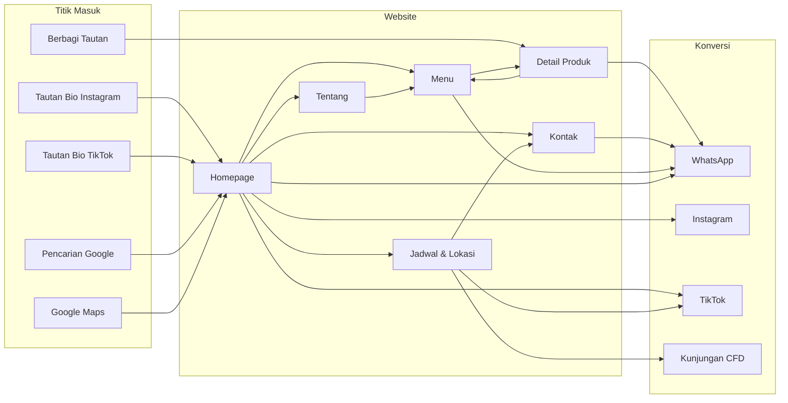

---

## 2. User Journey Detail

### Journey 1 — Nadia: Penemuan via TikTok Live

**Konteks:** Nadia, mahasiswi UNHAS usia 20, menonton TikTok Live Delisert saat istirahat kuliah. Dia tertarik pada mochi tapi ragu karena tidak tahu harga dan cara pesan.

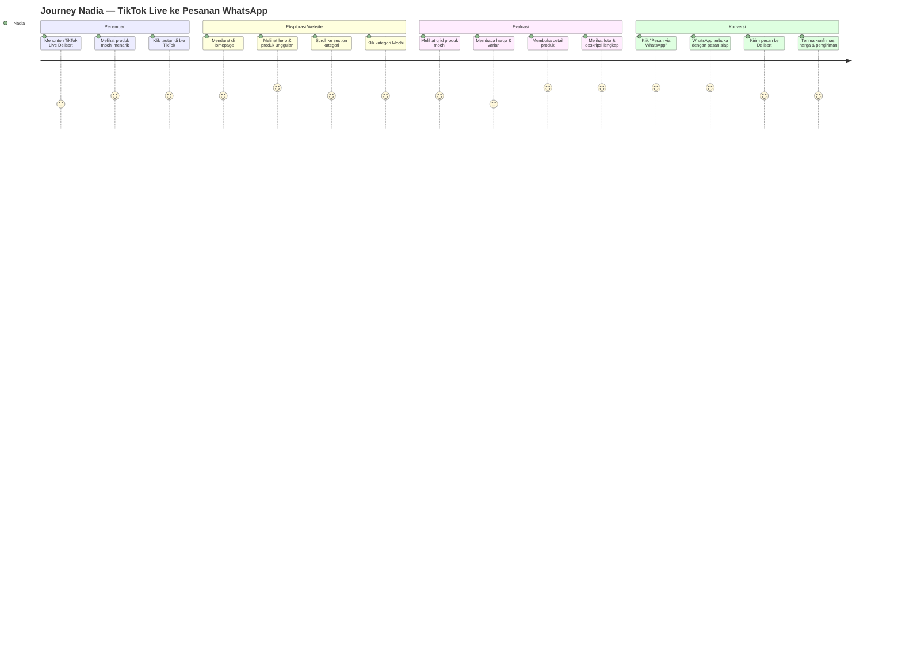

**Titik gesek (friction points) dan solusi:**

| Titik Gesek | Solusi Desain |
|---|---|
| Tidak tahu harga | Tampilkan harga jelas di kartu produk; jika belum ada, tampilkan "Hubungi untuk harga" secara elegan |
| Tidak yakin varian | Tampilkan daftar varian di kartu dan detail produk |
| Ragu chat WA tanpa info | Berikan informasi lengkap sebelum CTA WhatsApp |
| Pesan WA kosong | Isi otomatis dengan nama produk dan varian |

---

### Journey 2 — Nadia: Mencari Lokasi CFD Minggu

**Konteks:** Hari Minggu, Nadia ingin dessert dan tahu Delisert berjualan di CFD.

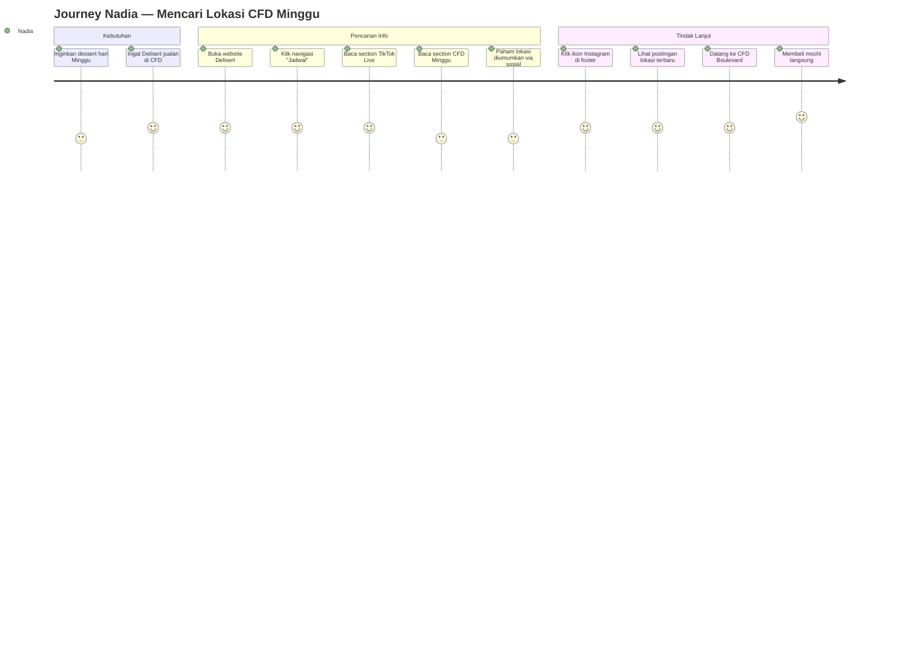

**Titik gesek dan solusi:**

| Titik Gesek | Solusi Desain |
|---|---|
| Tidak tahu lokasi pasti hari ini | Jangan tampilkan jam pasti; arahkan ke sosial media dengan CTA jelas |
| Khawatir lokasi berubah | Tegaskan bahwa titik penjualan bersifat sementara |
| Perlu info cepat | Section CFD harus mudah ditemukan dari navigasi utama |

---

### Journey 3 — Raka: Pesanan Mango Sticky Rice untuk Kantor

**Konteks:** Raka, karyawan kantor usia 28, ingin pesan mango sticky rice untuk dibagikan ke tim besok.

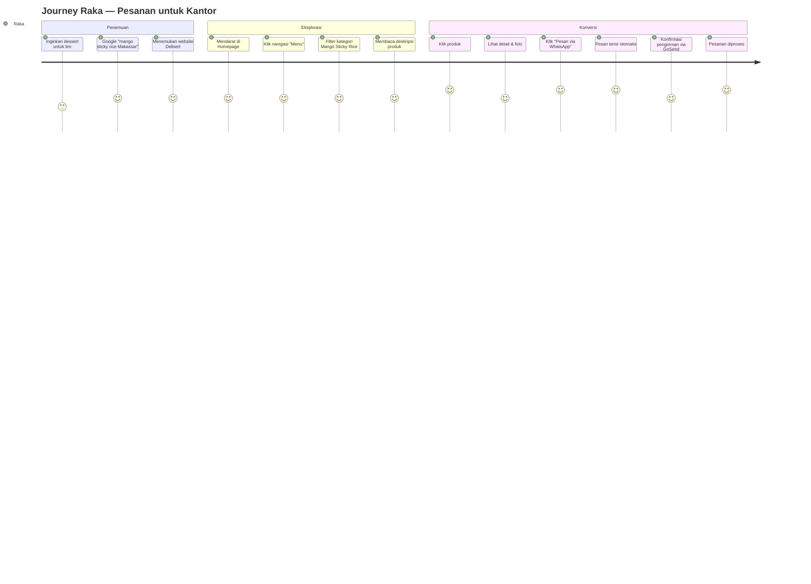

**Titik gesek dan solusi:**

| Titik Gesek | Solusi Desain |
|---|---|
| Tidak tahu bisa dikirim | Section pengiriman di halaman Kontak |
| Tidak tahu cara pesan jumlah banyak | Pesan WA terisi otomatis memudahkan penyesuaian |
| Ingin cepat | Satu klik dari produk ke WhatsApp |

---

### Journey 4 — Sari: Mencari Kue Ulang Tahun Anak

**Konteks:** Sari, ibu rumah tangga usia 34, anak ulang tahun minggu depan. Ingin kue yang berbeda.

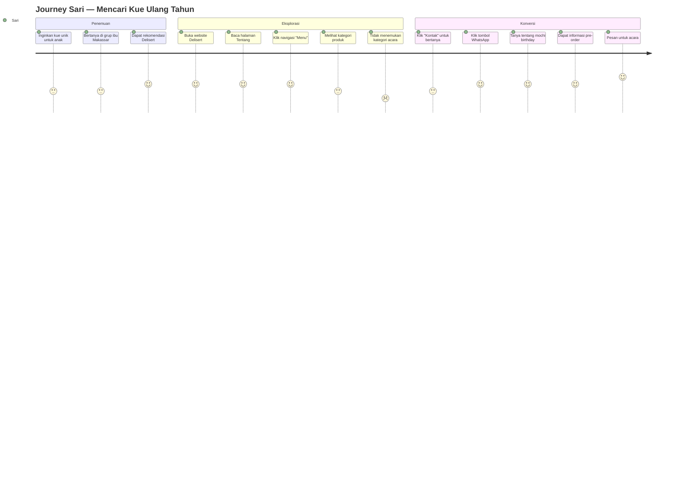

**Titik gesek dan solusi:**

| Titik Gesek | Solusi Desain |
|---|---|
| Kategori "Mochi Birthday" belum ada di MVP | Sampaikan melalui WhatsApp; tambahkan kategori di Fase 2 |
| Tidak tahu lead time pre-order | Instruksi pre-order di detail produk (Fase 2); sementara via WA |
| Ingin yakin kualitas | Halaman Tentang dan testimoni (Fase 2) |

**Catatan produk:** Journey ini mengungkap kebutuhan kategori "Mochi Birthday" dan "Small Wholecake" yang terlihat di story highlights Instagram. Direkomendasikan masuk Fase 2.

---

### Journey 5 — Pengunjung Pertama Kali: Membangun Kepercayaan

**Konteks:** Pengunjung yang belum pernah mendengar Delisert, datang dari pencarian atau berbagi tautan.

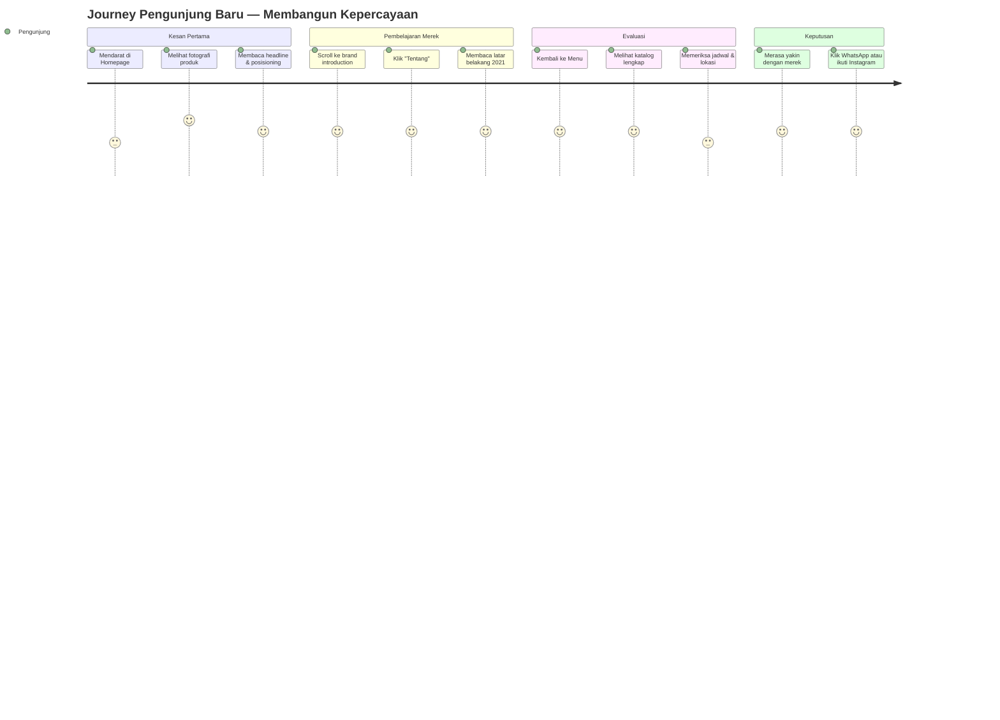

**Titik gesek dan solusi:**

| Titik Gesek | Solusi Desain |
|---|---|
| Tidak yakin merek ini nyata | Fotografi asli berkualitas, informasi "Sejak 2021" |
| Tidak yakin halal | Tampilkan status klaim halal sesuai verifikasi; jangan klaim sertifikasi |
| Tidak yakin cara pesan | Alur pemesanan yang jelas di halaman Kontak |

---

## 3. Alur Fungsional Detail

### 3.1 Alur Pemesanan WhatsApp

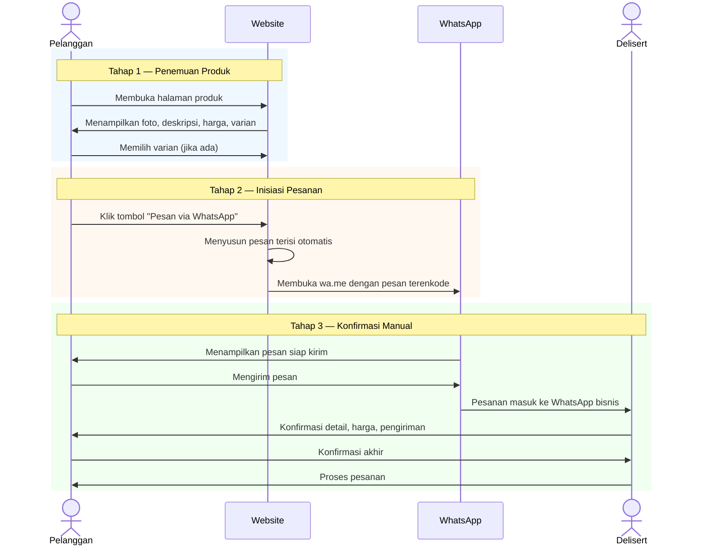

**Format pesan terisi otomatis:**

Dari halaman detail produk dengan varian:
```
Halo Delisert! Saya ingin memesan:

Produk: Mochi Matcha
Varian: Isi 8 pcs
Harga: Rp 35.000

Apakah produk ini tersedia?
```

Dari navigasi atau homepage:
```
Halo Delisert! Saya ingin memesan produk Delisert.
```

**Aturan penyusunan pesan:**
- Sertakan nama produk ketika pengguna mengklik dari halaman produk
- Sertakan varian terpilih ketika ada
- **Tidak** sertakan harga jika harga belum dikonfirmasi pemilik
- Gunakan Bahasa Indonesia yang sopan
- Encode URL dengan benar (`encodeURIComponent`)

---

### 3.2 Alur Filter Kategori

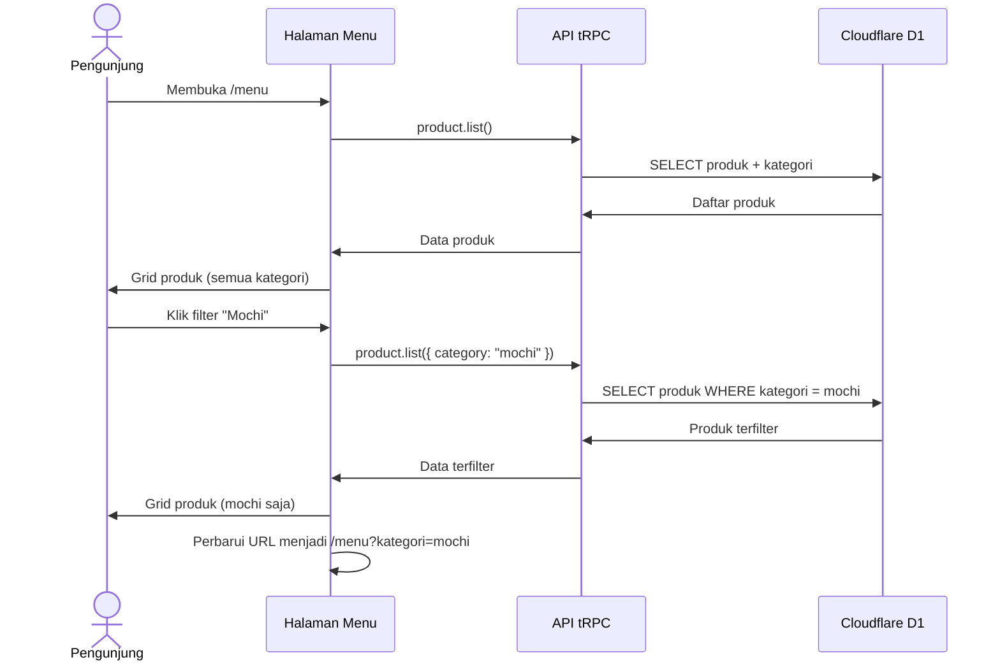

---

### 3.3 Alur Navigasi Mobile

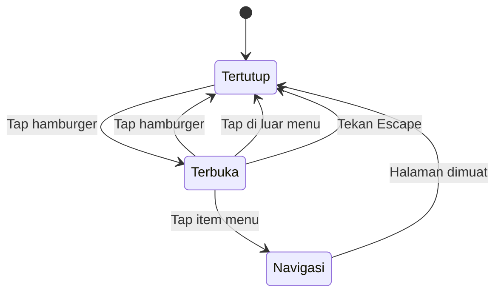

---

### 3.4 Alur Berbagi Tautan Produk

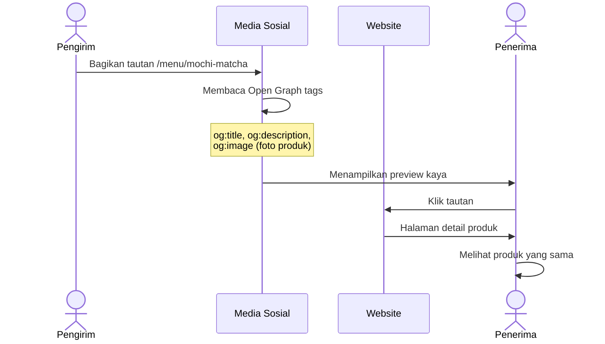

---

## 4. Peta Halaman dan Aksi

| Halaman | Aksi Utama | Aksi Sekunder |
|---|---|---|
| `/` | Klik CTA Menu, klik CTA WhatsApp | Klik kategori, klik sosial, scroll ke jadwal |
| `/tentang` | Membaca cerita merek | Klik CTA Menu, klik WhatsApp |
| `/menu` | Filter kategori, klik produk | Klik WhatsApp per kartu |
| `/menu/$slug` | Klik "Pesan via WhatsApp" | Klik produk terkait, lihat galeri, pilih varian |
| `/jadwal` | Membaca jadwal, klik ikon TikTok | Klik Google Maps, klik sosial |
| `/kontak` | Klik tombol WhatsApp | Klik Instagram, klik TikTok, baca instruksi |

---

## 5. Prinsip Interaksi

### 5.1 Umpan Balik (Feedback)

| Aksi | Umpan Balik |
|---|---|
| Klik tombol WhatsApp | Membuka aplikasi/WhatsApp Web (tidak ada feedback internal perlu) |
| Filter kategori | Grid diperbarui, URL berubah, indikator filter aktif |
| Buka menu mobile | Animasi slide, overlay, tutup dengan Escape |
| Hover kartu produk | Elevasi halus, transisi warna |
| Scroll | Section muncul dengan reveal halus (jika tidak mengganggu performa) |

### 5.2 Status dan Kondisi

| Kondisi | Perilaku |
|---|---|
| Produk habis | Kartu tetap tampil dengan badge "Habis", CTA WhatsApp dinonaktifkan atau diubah menjadi "Tanya Ketersediaan" |
| Harga belum tersedia | Tampilkan "Hubungi untuk harga" bukan angka kosong |
| Kategori kosong | Empty state dengan pesan dan CTA ke kategori lain |
| Slug tidak ditemukan | Halaman 404 dengan tautan kembali ke Menu |
| Gambar gagal muat | Placeholder dengan alt text, tidak merusak layout |

### 5.3 Mobile-First

| Elemen | Perilaku Mobile |
|---|---|
| Navigasi | Hamburger menu, sticky |
| Grid produk | 1 kolom, kartu full-width |
| Tombol WhatsApp | Ukuran besar, mudah dijangkau jempol |
| Teks | Minimal 16px untuk body |
| Target sentuh | Minimal 44×44px |
| Gambar | Responsif, lazy load |

---

## 6. Alur Konten (Content Flow)

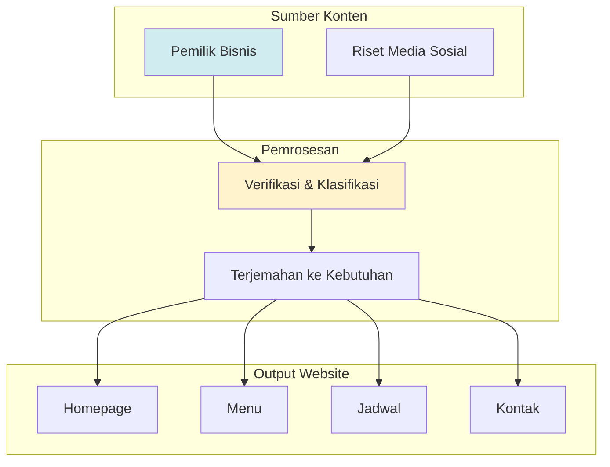

**Aturan alur konten:**
1. Setiap konten dari pemilik bisnis diverifikasi sebelum publikasi.
2. Informasi yang tidak terkonfirmasi tidak ditampilkan sebagai fakta.
3. Klaim pemasaran ditandai status verifikasinya.
4. Perubahan konten memerlukan pembaruan dokumen PRD.

---

*Dokumen ini terintegrasi dengan `docs/PRD.md` dan `docs/PRODUCT_REQUIREMENTS.md`.*
